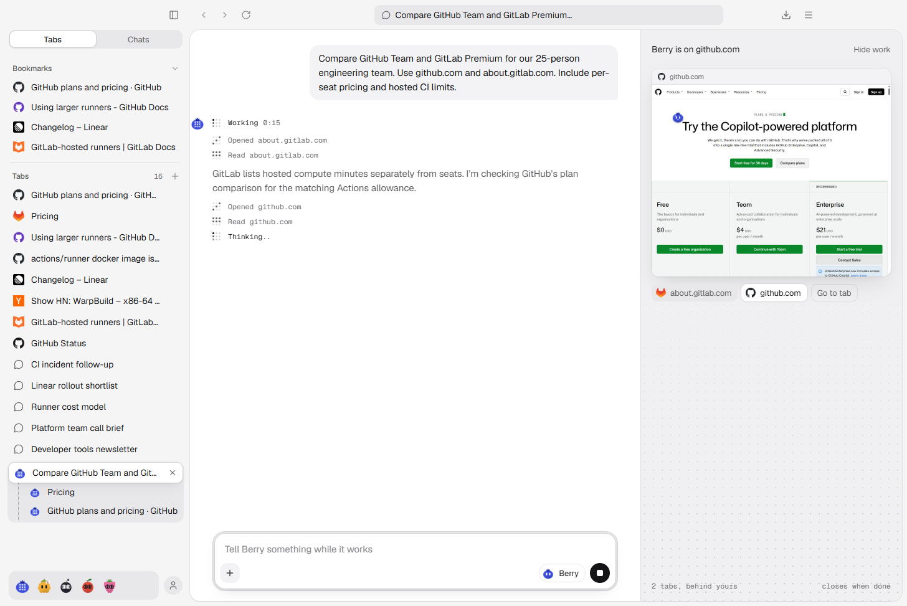
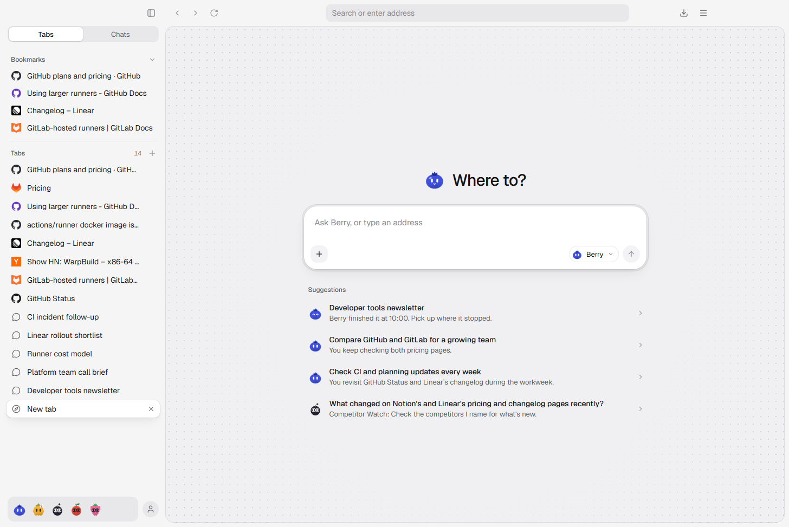
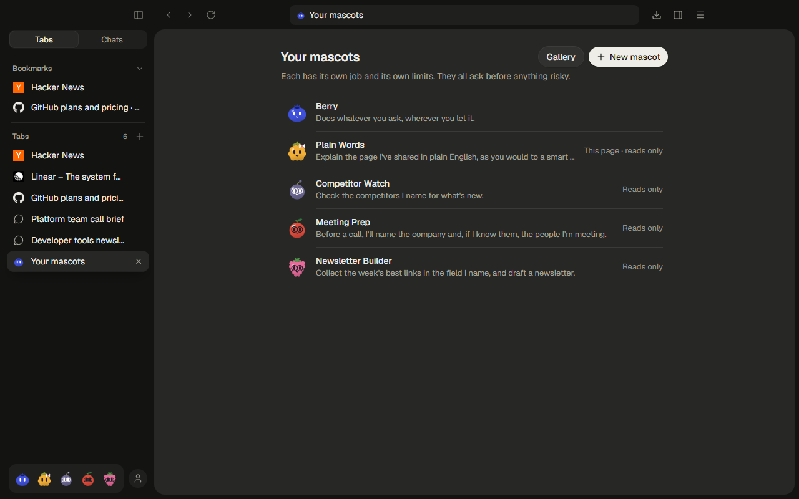
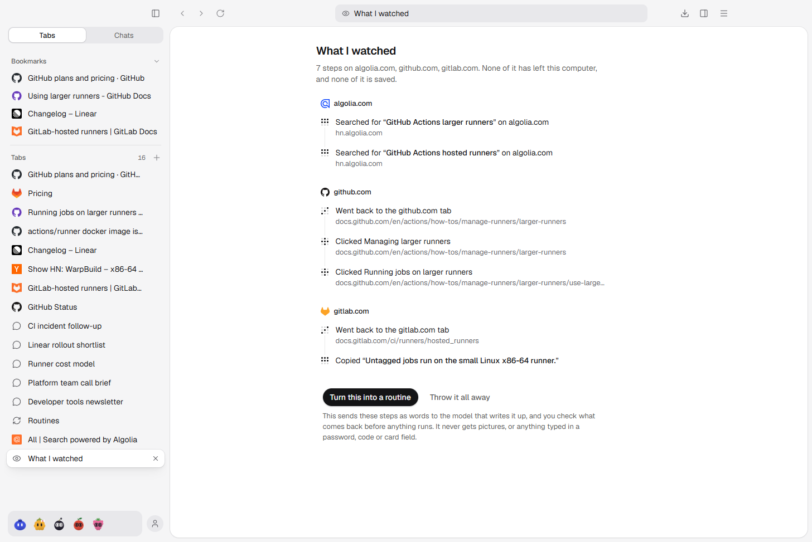
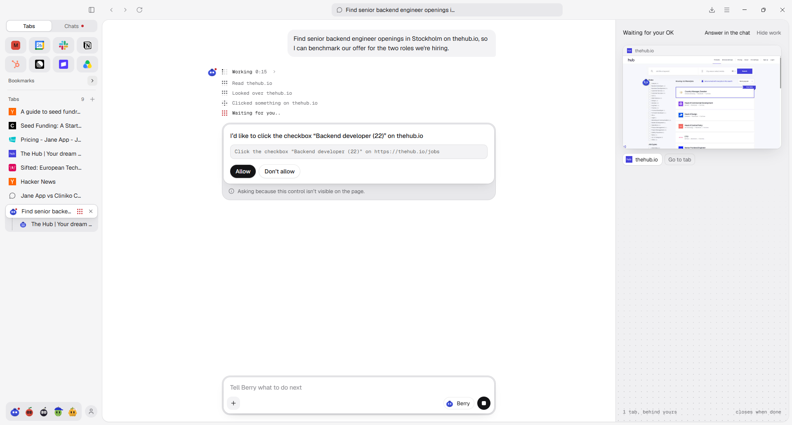

# Blueberry

Blueberry is an AI browser that can do jobs in your tabs. Ask Berry to research a question, compare sites or follow a process you repeat. Watch it work beside the chat and step in when it needs you.

[Visit the Blueberry website](https://blueberry-browser.netlify.app).



## What it does

### Browse and work in the same window

Blueberry has tabs, history, bookmarks, downloads, find, zoom and site permissions. Choose a vertical sidebar or horizontal tabs, and a light or dark appearance. In the Pips design, small grids of dots mark what a mascot is doing and when it needs you.

The new tab page is where you type an address or ask a mascot to do something. It shows jobs waiting for you and suggests chats to pick up, jobs to try, or routines and mascots based on your recent activity. Import history from Chrome, Brave or Edge to help it get started. On macOS you can also import from Arc.



### Jobs that keep going when you leave

A job can open tabs behind yours. The working view shows live pictures of the tabs it uses, so you can follow along without leaving the chat. Save a job as a routine to run it on a schedule.

With a cloud browser and a runner set up, cloud jobs and routines keep going while your computer is off. You can bring along sign-ins for sites you choose. The phone page lets you start cloud jobs, review approvals and take over when a site needs you. For jobs running on your computer, you can connect your own Telegram bot to answer from your phone.

### Your mascots and the Gallery

Berry is the built-in blueberry mascot. A profile that starts with only Berry also gets four starters from the Gallery. They are Plain Words, Competitor Watch, Meeting Prep and Newsletter Builder. The Gallery also includes Prospector, Follow-up, Lead Qualifier, Talent Scout and Pipeline Tidy.

Make your own mascot with a name, a berry look, instructions and limits on its sites and tools. A mascot can suggest remembering a preference after a job. You choose what it keeps and can remove it later.

You can review a Gallery mascot's instructions and permissions before adding it. With publishing set up, you can share a mascot's public page. Open in Blueberry takes the reader to that mascot's review.



### Show Berry how

Open Show Berry how from Routines, do the job once in the browser and press **Done**. Read the notes, leave out any steps you don't need, and turn what's left into a draft routine. It watches the tab in front while recording and keeps passwords out of the notes.



### Use Blueberry from other apps

You can turn on Berry on the desktop and start a browser job from another app. The desktop mascot works in Blueberry's tabs.

Claude Code and Claude Desktop can hand jobs to Blueberry through the local MCP connection. With the cloud relay set up, ChatGPT and Claude can start jobs too. You can also opt in to running relay jobs on your Mac while Blueberry is open.

## Safety

- By default, a mascot asks before taking an action the app marks as risky. The approval card shows the exact action and why it needs permission. If the page changes after you allow it, the action is canceled. Cloud runner jobs ask at least as often as the default setting.
- Blueberry enforces a mascot's site and tool limits in the browser tools.
- A mascot hands over the tab for a sign-in, code or CAPTCHA and waits until you give it back. Only you can approve an action or complete a handoff.
- The working view sends its pictures only to the browser window.



## How it's built

- Electron 45 with `BaseWindow` and one `WebContentsView` per tab, React 19, TypeScript, Tailwind and Vite through electron-vite.
- LangChain for the agent, with OpenAI or Anthropic models.
- SQLite through `node:sqlite` for chats, history and routines, and JSON files for the rest.
- `playwright-core` over CDP for the cloud browser, on Browserbase.
- Supabase for accounts, the Gallery and cloud jobs, with row-level security and security definer functions, tested on real Postgres in WebAssembly with PGlite.
- A plain Node runner for Railway, and a static site for Netlify with no build.
- Vitest for unit tests and Playwright for end-to-end tests against the built app.

[docs/ARCHITECTURE.md](docs/ARCHITECTURE.md) walks through how it fits together.

## Running it

You need Node 24 or later and pnpm.

```sh
pnpm install
cp .env.example .env    # set LLM_PROVIDER and one key, OPENAI_API_KEY or ANTHROPIC_API_KEY
pnpm dev
```

You can also enter an AI key during first run or in Settings > Connections > AI service. If you use an environment file with a packaged app (`pnpm exec electron-builder --dir`), place it in the app's user data folder. On a Mac that is `~/Library/Application Support/blueberry-browser/`.

Accounts, publishing and remote jobs need additional setup.

- **Accounts and publishing to the Gallery** need a Supabase project with the migrations in `supabase/migrations`, and `SUPABASE_URL` and `SUPABASE_PUBLISHABLE_KEY` in `.env`.
- **The public mascot pages and the phone page** are in `site/`, deployed to Netlify with `pnpm run site:deploy` after setting `site/config.js`.
- **Cloud jobs** need a Browserbase API key and project id in Settings > Connections > Cloud. Keeping them going with the Mac off, the phone page's jobs and the relay for ChatGPT and Claude need the runner. [runner/README.md](runner/README.md) has the steps.
- **Replies from the phone** to jobs on this computer need a Telegram bot of your own, connected in Settings > Connections > Phone. Jobs on the cloud runner are answered in the app or on the phone page instead.

| Command | What it does |
|---|---|
| `pnpm install` | Install dependencies |
| `pnpm dev` | Run the app with hot reload |
| `pnpm run typecheck` | Typecheck main, preload, tests and renderers |
| `pnpm run format:check` | Check formatting with Prettier |
| `pnpm run lint` | Lint. Any warning or error fails, and a comment can't turn a rule off: change it in `eslint.config.mjs` |
| `pnpm run test` | Run unit tests in `src/` with Vitest |
| `pnpm exec electron-vite build` | Build into `out/` |
| `pnpm run test:e2e` | Run Playwright against `out/`, so build first |
| `pnpm exec electron-builder --dir` | Package an unsigned app into `dist/` |
| `pnpm run eval` | Run Berry on real websites with the real model, which costs money. See [evals/README.md](evals/README.md) |
| `pnpm run site:build` | Regenerate what `site/` and the mascot drawn on pages take from the app. Run it after changing any of them |
| `pnpm run site:deploy` | Deploy `site/` to Netlify, as it is, with `netlify.toml`. Needs `npx netlify login` and a linked site first |
| `pnpm run push:keys` | Print a new VAPID key pair for notifications on the phone page |
| `pnpm run runner:build` | Bundle the cloud runner into `runner/dist/`. `pnpm run runner:start` runs it |
| `pnpm run verify` | Run CI checks and end-to-end tests |
