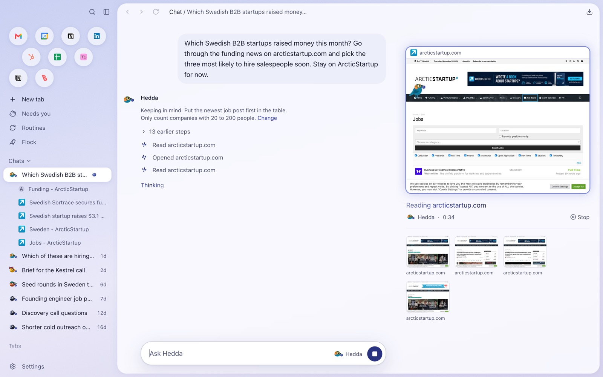
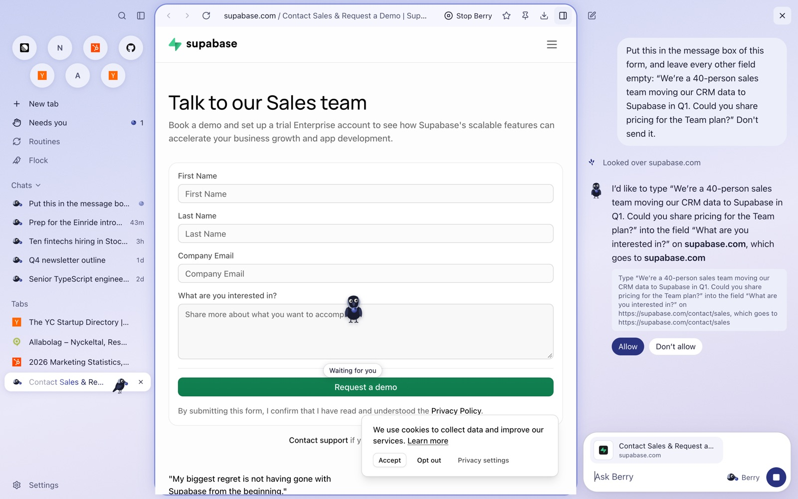
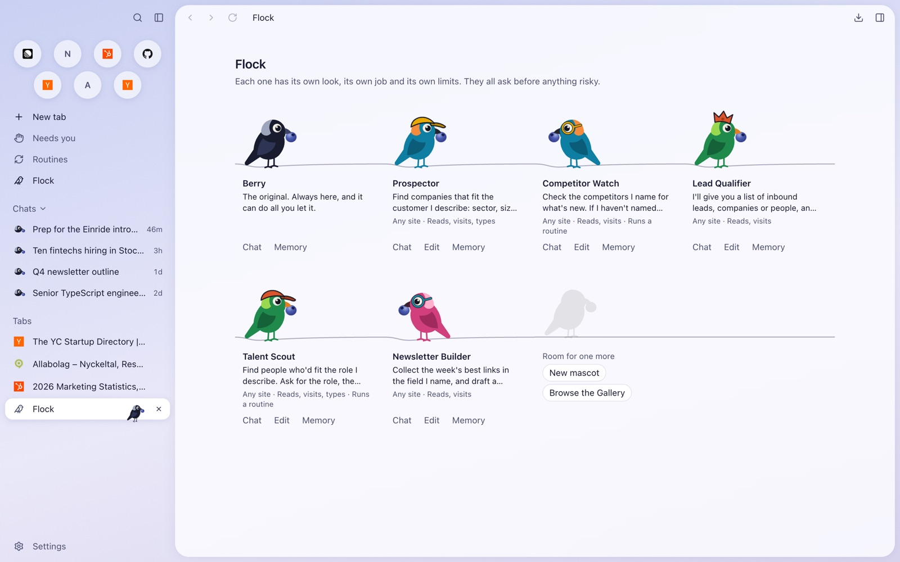
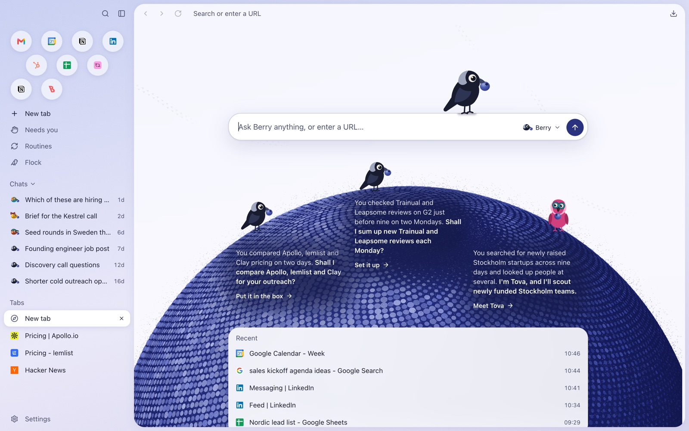
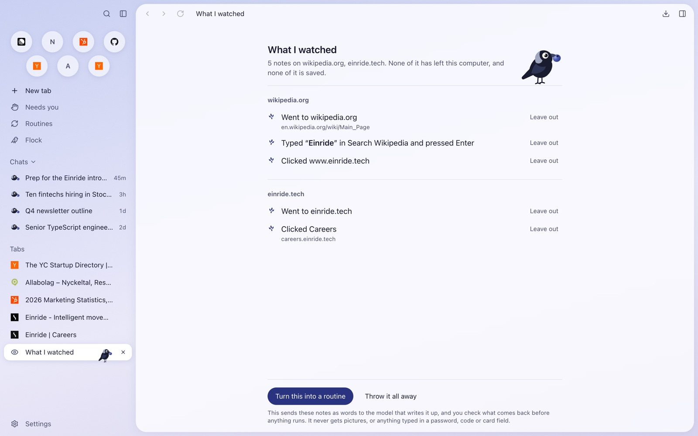

# Blueberry

An AI browser that works on your behalf. Grow a flock of birds for the jobs you repeat, and it notices what you do and offers to take it over.

<!-- video -->



## What it does

Blueberry is a browser first, designed for the Mac: tabs, history, bookmarks, downloads, find, zoom and site permissions, in a window made to look like the skin of a blueberry. Berry, a jackdaw with a blueberry in its beak, does jobs in the browser when you ask, and you can grow a flock of other birds beside it, each with its own name, look, instructions and limits.

Strawberry has all of that too. The sections below are where Blueberry tries to do better than Strawberry does today, each starting from what's missing there. What I say about Strawberry is how I understand it as of November 2026.

### Jobs that keep going when you leave

Strawberry's routines run on your own computer, so they only run while it's on and awake, which makes them much less useful than they sound. In Blueberry a job or a routine can run in a browser in the cloud instead, on Browserbase, with the sign-ins you chose to bring along, and a runner on Railway keeps it going with the Mac closed. The phone page follows those jobs from anywhere: start one as any bird, watch the live view, answer what it asks, or take over for a sign-in. Strawberry has nothing like it on the phone.

### Answering from your phone

Strawberry marks a chat that needs you, for a sign-in or anything else, but only on the computer. A job that stops for a 2FA code while you're at lunch has wasted the hour. In Blueberry, everything a job waits on is in one Needs you list, and with your own Telegram bot connected, the same items reach your phone: Allow and Don't allow as buttons, a reply for a question, and a code typed straight into the page without the model seeing it. That makes it practical to leave several jobs running at once and walk away. Telegram is one channel behind a small interface, so iMessage or WhatsApp could follow, and so could sign-ins from the phone.

### Your birds, from ChatGPT and Claude

Strawberry lets you connect MCP servers to it, but it isn't one itself, so nothing else can use it. Most people will keep ChatGPT or Claude open next to whatever browser they use, so Blueberry doesn't try to replace them. It gives them your browser. Claude Code and Claude Desktop on the same computer can hand whole jobs to your birds over MCP, and with the runner deployed, so can ChatGPT and Claude on the web, even from your phone with the Mac off. The chat keeps its threads and plans, the bird brings your logins and what it sees in the browser, and every job runs with the bird's limits and approvals. Both get better: the chat app can act in your real browser, and the bird gets the context of everything you planned there. You get something out of Blueberry without switching browsers all at once, which also fits where Strawberry seems to be heading, as an agent platform rather than only a browser.

### Show Berry how

Strawberry's advice for making a routine is to talk it through with your companion, which still means describing the job well enough in words, and that's harder than doing it. It has no built-in way to just show it. In Blueberry you press Show Berry how, do the job once, and press Stop. Berry writes up what it saw as notes you can read and trim, and a cheap model turns them into a routine with numbered steps and the values that might change. It watches only the tab in front, only between start and Stop, and never keeps what's typed into a password or payment field.

### The Gallery

Strawberry gives each companion a public page you can send to someone, and has about ten official companions to pick from, but there's nowhere to browse what other people made. That's a real gap: a new user often can't see why they'd want more than one assistant. The Gallery shows them, and it doubles as marketing, since people share their birds and see how often they're added. It has starter birds for work, such as Prospector, Meeting Prep and Competitor Watch, and, with a server set up, the birds other people published. Every entry shows its instructions and permissions word for word before you add it, and the copy is yours from then on. Each published bird also has a public page you can send to a colleague, whose Open in Blueberry button opens its review in the app through a `blueberry://` link. A link never adds or runs anything.

### Suggestions that keep coming

As far as I know, Strawberry's suggestions come from the onboarding interview: the companion writes a few prompts from what you told it, and they don't keep changing afterwards or suggest new companions. It can recommend routines from what you've done. In Blueberry, suggestions on the new tab page come from what you actually do. At most about once an hour, a cheap model reads a digest of your recent browsing, chats and routine runs and proposes a prompt, a routine or a new bird, and code checks each one against what it cites before it shows. They change as your week does. On the first day, Blueberry can bring in the last 90 days of history from Chrome, Arc, Brave or Edge, so the first suggestions are already about you. As far as I can tell, Strawberry imports history too but doesn't use it for its first suggestions.

### Berry on the desktop

In Strawberry, work starts inside the browser, but most work happens in other apps. Turned on in Settings, Berry waits tucked behind an edge of the screen, above every app, and `⌥Space` gives it a job from anywhere. The job runs in the browser where you're signed in. It never reads the screen, the clipboard or another app. It's a first step toward an agent that isn't tied to one window, and it could grow into working on the desktop itself, if the agent platform matters more than the browser.

### The rest

The flock itself, routines on a schedule, jobs that work in tabs behind yours with a live picture of them beside the chat, and birds that keep a habit only when you say yes and show every word they keep. Strawberry has all of these, and they work much the same here. Blueberry needs them because everything above is built on them. The same goes for the safety rules below, which every AI browser needs.

## Safety

- By default, a bird stops before anything risky on an approval card with the exact sentence of what will happen, and does nothing if the page changed after you allowed it. A job on the cloud runner never asks less than that.
- A bird's limits only narrow what it can do, and are enforced in the tool layer, not the prompt.
- A bird never asks for a password or code. A sign-in, code or captcha is handed to you in its tab, which no job can reach until you're done, and a code sent from your phone is typed by code the model can't call. The model is only told that a code went in.
- Only you can answer an approval. No MCP app, relay client or cloud runner can.
- The working view's pictures go only to the window, never to the model or the disk, and a cloud live view never goes to the model.
- No service key is in the repo, the app or the runner. Everything uses Supabase's publishable key and a signed-in user's session.

## More screenshots

<table>
<tr>
<td width="50%"><br>An approval card says exactly what will happen before anything does.</td>
<td width="50%"><br>The flock: Berry and five birds from the Gallery, each with its own limits.</td>
</tr>
<tr>
<td width="50%"><br>Suggestions on the new tab page, written from what you browsed.</td>
<td width="50%"><br>Show Berry how: the notes from one recorded job, before they become a routine.</td>
</tr>
</table>

## How it's built

- Electron 45 with `BaseWindow` and one `WebContentsView` per tab, React 19, TypeScript, Tailwind and Vite through electron-vite.
- LangChain for the agent, with OpenAI or Anthropic models.
- SQLite through `node:sqlite` for chats, history and routines, and JSON files for the rest.
- `playwright-core` over CDP for the cloud browser, on Browserbase.
- Supabase for accounts, the Gallery and cloud jobs, with row-level security and security definer functions, tested on real Postgres in WebAssembly with PGlite.
- A plain Node runner for Railway, and a static site for Netlify with no build.
- Vitest for unit tests and Playwright for end-to-end tests against the built app.

[docs/ARCHITECTURE.md](docs/ARCHITECTURE.md) walks through how it fits together.

## Running it

You need Node 24 or later and pnpm.

```sh
pnpm install
cp .env.example .env    # set LLM_PROVIDER and one key, OPENAI_API_KEY or ANTHROPIC_API_KEY
pnpm dev
```

That's the whole browser, with Berry, the flock, routines, Suggestions, Show Berry how, Needs you and the bundled Gallery. The rest needs something set up:

- **Accounts and publishing to the Gallery** need a Supabase project with the migrations in `supabase/migrations`, and `SUPABASE_URL` and `SUPABASE_PUBLISHABLE_KEY` in `.env`.
- **The public mascot pages and the phone page** are in `site/`, deployed to Netlify with `pnpm run site:deploy` after setting `site/config.js`.
- **Cloud jobs** need a Browserbase API key and project id in Settings > Cloud. Keeping them going with the Mac off, the phone page's jobs and the relay for ChatGPT and Claude need the runner. [runner/README.md](runner/README.md) has the steps.
- **Replies from the phone** to jobs on this computer need a Telegram bot of your own, connected in Settings > Phone. Jobs on the cloud runner are answered in the app or on the phone page instead.

| Command | What it does |
|---|---|
| `pnpm install` | Install dependencies |
| `pnpm dev` | Run the app with hot reload |
| `pnpm run typecheck` | Typecheck main, preload, tests and renderers |
| `pnpm run lint` | Lint. Warnings are allowed, errors fail CI |
| `pnpm run test` | Run unit tests in `src/` with Vitest |
| `pnpm exec electron-vite build` | Build into `out/` |
| `pnpm run test:e2e` | Run Playwright against `out/`, so build first |
| `pnpm exec electron-builder --dir` | Package an unsigned app into `dist/` |
| `pnpm run eval` | Run Berry on real websites with the real model, which costs money. See [evals/README.md](evals/README.md) |
| `pnpm run site:build` | Regenerate what `site/` and the bird drawn on pages take from the app. Run it after changing any of them |
| `pnpm run site:deploy` | Deploy `site/` to Netlify, as it is, with `netlify.toml`. Needs `npx netlify login` and a linked site first |
| `pnpm run push:keys` | Print a new VAPID key pair for notifications on the phone page |
| `pnpm run runner:build` | Bundle the cloud runner into `runner/dist/`. `pnpm run runner:start` runs it |
| `pnpm run verify` | Typecheck, lint, unit tests, build and end-to-end tests, the same as CI on macOS |

## How it was made

Blueberry was built with coding agents: Claude Code wrote the changes, and Codex reviewed them. Each feature was one PR, merged in order before the next began, so the [closed pull requests](https://github.com/Luddeforsberg/blueberry-browser/pulls?q=is%3Apr+is%3Aclosed) read as the build history. GitHub Actions is out of minutes for now, so `pnpm run verify` runs locally in place of CI, and each PR says what it printed.

What Berry can do is measured on real websites with the real model, through the jobs in [evals/](evals/). On the first run, 14 of 29 jobs were done on every run. After the work on the agent, 25 of 29 were, though 17 of those ran once. The results and notes are in [evals/results/](evals/results/).

It began as a fork of the Blueberry Browser challenge repo.
