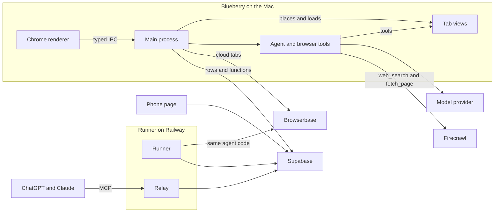

# How Blueberry fits together

A walk through the main parts, for someone reading the code for the first time. [AGENTS.md](../AGENTS.md) has the same ground file by file, with every rule, and [DESIGN.md](../DESIGN.md) has the UI.

## Windows, views and the layout

A window is a `BaseWindow` holding a stack of `WebContentsView`s ([src/main/window/Window.ts](../src/main/window/Window.ts)). At the bottom is one window-sized chrome view, which draws the sidebar or tab row, the toolbar, the chat panel and the glass. Above it is one view per tab, with no preload and no Node access. On top sit small views for anything that floats over a page: the collapsed sidebar when it slides out, and in the horizontal layout Chats and a mascot's card opened from the toolbar, both in the overlay view ([src/main/window/Window.ts](../src/main/window/Window.ts)), the find bar ([src/main/window/FindBar.ts](../src/main/window/FindBar.ts)) and the site permission prompt ([src/main/settings/PermissionPromptView.ts](../src/main/settings/PermissionPromptView.ts)).

Views stack by order, so CSS in the chrome can never draw over a page. That's why floating things get views of their own, each only as large as what it shows, except what opens from the horizontal toolbar: its view covers everything under the toolbar, so a press outside the panel closes it.

Every chrome view loads the same React renderer in [src/renderer/chrome](../src/renderer/chrome), with a `view` parameter saying which part to draw ([src/main/window/chromeView.ts](../src/main/window/chromeView.ts)). Internal pages, such as the new tab page, Your mascots, Routines, Needs you and Settings, open as tabs with no web view, drawn by the chrome on the same card a web page sits on.

[src/main/window/Layout.ts](../src/main/window/Layout.ts) is the only place that decides where regions go. `computeLayout` turns the window size, layout mode and panel widths into rectangles. `Window` places the tab views with them and sends the same rectangles to the chrome renderer, which draws each region there. Nothing else hard-codes a size.

## The browser itself

Each tab is a [src/main/tabs/Tab.ts](../src/main/tabs/Tab.ts) around its own `WebContentsView`. Open tabs and the layout are saved to `session.json` by [src/main/tabs/Session.ts](../src/main/tabs/Session.ts) soon after each change, and a restored tab gets no view until it's first shown, so a long session opens fast. When a page calls `window.open`, `Window.openLinksInTabs` makes a real popup as a new tab around the page Electron created, so the opener can still talk to it, as "Continue with Google" sign-ins need.

[src/main/settings/sessionHandlers.ts](../src/main/settings/sessionHandlers.ts) connects downloads ([src/main/library/Downloads.ts](../src/main/library/Downloads.ts)) and site permissions ([src/main/settings/SitePermissions.ts](../src/main/settings/SitePermissions.ts)) to the session once, before anything loads. A site may use only what the user allowed it, and anything the list doesn't name is refused. History, bookmarks, find in page and zoom work as in any browser, and the menu is in [src/main/menus/Menu.ts](../src/main/menus/Menu.ts). History from another browser comes in through [src/main/library/browserHistory.ts](../src/main/library/browserHistory.ts), which copies a Chromium profile's `History` file to a temporary folder, reads only address, title and time, and deletes the copy.

## The typed IPC contract

[src/shared/ipc.ts](../src/shared/ipc.ts) is the one contract between main and the renderer: every channel, its arguments, its result, and which chrome region may call it. It's types only, because the preload is sandboxed and can't load shared runtime code. [src/preload/chrome.ts](../src/preload/chrome.ts) exposes it to the renderer as `chromeAPI`.

`CHANNEL_REGIONS` in [src/main/window/ipc.ts](../src/main/window/ipc.ts) lists the regions for each channel, and [src/main/window/EventManager.ts](../src/main/window/EventManager.ts) registers every handler through one function that checks the caller first. A call is refused unless it comes from the main frame of one of the named views, at the page that view loaded. So a web page, or a frame inside the chrome, can't call anything, and only the permission prompt can answer a permission request.

## The agent and the browser tools

Every chat goes through [src/main/chats/Chats.ts](../src/main/chats/Chats.ts), which saves it to SQLite and gets the reply from a LangChain agent built in [src/main/chats/agent.ts](../src/main/chats/agent.ts). The model is OpenAI or Anthropic, chosen in `.env`, and LangChain only loads with the first message. A cheaper model from the same provider names chats and does the small jobs elsewhere in the app.

What Berry can do in the browser is in [src/main/tools/browserTools.ts](../src/main/tools/browserTools.ts): `list_tabs`, `read_page`, `find_in_page`, `list_elements`, `click`, `type_text`, `choose_option`, `hover`, `drag`, `press_key`, `screenshot`, `go_to`, `open_tab`, `web_search`, `fetch_page`, `ask_user`, `hand_to_user` and a few more. They're plain definitions that `agent.ts` wraps as LangChain tools. `browserTools.ts` puts them together, in the order the model sees, from a file for each kind: reading a page, the mouse, the keyboard, asking the user, tabs and the web. Whether a call asks first is decided in [src/main/tools/askFirst.ts](../src/main/tools/askFirst.ts), and a mascot's limits in [src/main/tools/mascotLimits.ts](../src/main/tools/mascotLimits.ts). What they run in a page is in [src/main/tools/pageScripts.ts](../src/main/tools/pageScripts.ts), in an isolated world that shares the page's DOM but not its variables. Scripts in a frame from another origin run in that frame's own world, and nothing it says about itself is believed. Clicks and typing are real mouse and keyboard events sent to the tab where they can be ([src/main/tools/pageInput.ts](../src/main/tools/pageInput.ts)), aimed after the page settles, and a press that would land on anything but the named element is stopped. Frames from another origin, native pickers and drags, and a few fallbacks get scripted input instead.

Tabs a job opens stay behind the user. While a reply runs, its tabs show under the chat in the sidebar, and when it ends they close, except one the user took over or the one the reply points to. Their addresses are saved on the reply. The mascot drawn on the page while it works ([src/main/tools/PageActor.ts](../src/main/tools/PageActor.ts) and [src/main/tools/pageActorScript.ts](../src/main/tools/pageActorScript.ts)) only draws, and takes no clicks.

A run has a step limit of 120 model calls. On the last, tools are taken away and the model is asked to write up what it found, once more if it comes back empty, so a long job doesn't end with nothing.

`web_search` asks Firecrawl ([src/main/tools/webSearch.ts](../src/main/tools/webSearch.ts)) for a few results as title, address and snippet, which is faster than opening a search page and reading it. The key stays in main, the results are marked as untrusted, and a query that could carry data out asks first, by the same check as an address. `fetch_page` asks Firecrawl ([src/main/tools/webFetch.ts](../src/main/tools/webFetch.ts)) for a public page's main text as markdown, so reading a page is one call rather than opening a tab and reading it. It goes through the same check as `open_tab`, since the address goes out to Firecrawl and from there to the site, and a mascot limited to sites may only fetch from them, wherever a redirect ends. Firecrawl has none of the user's sign-ins, so Berry opens a tab to click, type, or read a signed-in page.

Beside the main chat, the working view ([src/main/window/WorkViews.ts](../src/main/window/WorkViews.ts) and [WorkingView.tsx](../src/renderer/chrome/src/components/WorkingView.tsx)) shows live pictures of the tabs a job is using, so the user can watch without leaving the chat. Those pictures go only to the chrome renderer, never to the model, a chat or the disk.

## One set of tools, two kinds of browser

The tools don't use Electron's tab directly. They work through `PageTarget` ([src/main/tools/pageTarget.ts](../src/main/tools/pageTarget.ts)), an interface of what they need: run a script in the page, list frames from other origins, take a screenshot, send input, load an address, wait for it to settle, and hold the page to allowed addresses for the length of an action. `createPageTools` is generic over it.

[src/main/tabs/Tab.ts](../src/main/tabs/Tab.ts) is the Electron implementation. [src/main/tools/CdpTab.ts](../src/main/tools/CdpTab.ts) is a page in a browser reached over the Chrome DevTools Protocol through `playwright-core`, in plain Node. That's how the same tools run in a Browserbase session ([src/main/cloud/browserbase.ts](../src/main/cloud/browserbase.ts) and [src/main/cloud/cloudBrowser.ts](../src/main/cloud/cloudBrowser.ts)), from the app or from the runner, which has no window. Tests use a local headless Chrome in its place ([src/main/cloud/localChrome.ts](../src/main/cloud/localChrome.ts)).

## Approvals and handoffs

A tool that changes something has a `describe` function, which gives the exact sentence of what will happen. Depending on the Ask before acting setting, and the tool's own `whyRisky` check, the call pauses through LangChain's human-in-the-loop middleware and shows a card with that sentence. The user answers through `chat:decide`. If the page changed after they allowed it, nothing happens and the model is told to look again. In the default mode, going to an address asks unless it's plainly safe, such as one the user gave or a plain address on a site the job has reason to be on. That reason never covers an address that could carry data out, such as one with a query.

Cards show in the chat, on Routines and on the Needs you page, which lists everything waiting ([src/renderer/chrome/src/pages/NeedsYouPage.tsx](../src/renderer/chrome/src/pages/NeedsYouPage.tsx)). With a Telegram bot connected, [src/main/phone/Phone.ts](../src/main/phone/Phone.ts) sends the same items from jobs on this computer to the user's phone through [src/main/phone/TelegramChannel.ts](../src/main/phone/TelegramChannel.ts), and answers go back through the same `chat:decide`.

A sign-in, code or captcha is a handoff. `hand_to_user` gives the tab to the user, and no job can reach it until they press I'm done. A code sent from the phone is typed into the field by [src/main/phone/codeEntry.ts](../src/main/phone/codeEntry.ts), the only thing that can use a held tab. The model is only told that a code went in, and for an hour `Chats` takes the code out of anything it's told in case the page shows it again, and that tab gives no screenshots.

## Routines and Show Berry how

A routine is a saved job with a schedule. [src/main/routines/Routines.ts](../src/main/routines/Routines.ts) checks what's due, keeps routines and their runs in `routines.db` ([src/main/routines/RoutineStore.ts](../src/main/routines/RoutineStore.ts)), and runs each through `Chats.runTask`, the same path as a chat with no page. [src/main/routines/routineSchedule.ts](../src/main/routines/routineSchedule.ts) holds the schedule rules. However many times were missed while the Mac was asleep, one run covers them. A routine can also run in the cloud instead (see The cloud path).

Show Berry how makes a routine from doing a job once by hand. [src/page/recorder](../src/page/recorder/watch.ts), run by [src/main/recordings/recorderScript.ts](../src/main/recordings/recorderScript.ts), watches the tab in front, in an isolated world of its own, and notes clicks, typing, choices, copies and pastes. Password fields are recognised before their value is read, so no secret leaves the page, and the clipboard is never read. [src/main/recordings/recordingTrail.ts](../src/main/recordings/recordingTrail.ts) turns that into notes the user can read and trim, with queries taken off addresses, and [src/main/recordings/Recordings.ts](../src/main/recordings/Recordings.ts) sends the notes to the cheap model, which writes the routine's steps and what might change next time. The routine's sites come from the notes in code, not from the model, and it can only reach those.

## Mascots and their limits

The mascots are saved in `mascots.json` by [src/main/mascots/MascotStore.ts](../src/main/mascots/MascotStore.ts), with Berry always first and never on file. The rules are in [src/shared/mascots.ts](../src/shared/mascots.ts): `parseMascotDraft` checks anything that becomes a mascot, whether typed, copied from the Gallery or sent from the phone, and `narrowSites` combines two lists of sites so the result can only be smaller.

A mascot's limits reach `createPageTools` as `limits`. Tools it wasn't given are dropped. `TOOL_NEEDS` says what each tool needs, and a tool missing from it goes to no limited mascot. Anything off its sites is refused before it's asked about, read or opened, and a screenshot is withheld while a frame from another site is on the page. Its name and instructions go into the prompt through [src/main/chats/mascotNote.ts](../src/main/chats/mascotNote.ts), after the safety rules, but no limit or approval ever reads the prompt.

The Gallery ([src/main/mascots/Gallery.ts](../src/main/mascots/Gallery.ts) and [src/main/mascots/mascotCatalog.ts](../src/main/mascots/mascotCatalog.ts)) copies exactly the version the user reviewed, through the same checks. [src/shared/publishing.ts](../src/shared/publishing.ts) holds the extra rules for anything from strangers. `blueberry://` links are read by [src/main/mascots/mascotLink.ts](../src/main/mascots/mascotLink.ts), which accepts only `blueberry://mascot/<uuid>` and only opens the review.

## Memory

What a mascot remembers is in `memory.json` ([src/main/memory/MemoryStore.ts](../src/main/memory/MemoryStore.ts)), apart from the mascot, so copying or publishing one can't take it along. After a job, `Chats` only asks the cheap model for an offer when `statesAHabit` in [src/main/memory/mascotMemory.ts](../src/main/memory/mascotMemory.ts) finds the user's own words saying something goes beyond this job. The model gets what the user typed, their answers and the site names, never a page or a step. An offer becomes a fact only when the user accepts it through `memory:decide`. `relevantFacts` picks what goes into each job, and `memoryNote` puts it in the prompt as preferences.

## Suggestions

[src/main/suggestions/Suggestions.ts](../src/main/suggestions/Suggestions.ts) decides what the mascots on the new tab page say. [src/main/suggestions/suggestionDigest.ts](../src/main/suggestions/suggestionDigest.ts) builds what the cheap model reads: browsing sessions, search queries, chats, routines, the mascots and earlier feedback, each item with a short id. Page text and full addresses aren't in it. The model proposes prompts, routines or new mascots citing those ids, at most about once an hour, and `verifyProposals` in [src/main/suggestions/suggestionProposals.ts](../src/main/suggestions/suggestionProposals.ts) drops any that cites an id that isn't there, or whose words on the card hold a number its evidence doesn't. Its sites are narrowed to the ones in its evidence, and a routine whose schedule doesn't match when the user really looked becomes a prompt instead. Without a model, the repeated-pattern rules in [src/main/suggestions/suggestionPatterns.ts](../src/main/suggestions/suggestionPatterns.ts) fill in.

## Berry on the desktop

With it on, a mascot waits at the edge of the screen when the user is in another app ([src/main/desktop/DesktopBerry.ts](../src/main/desktop/DesktopBerry.ts)), as a small near-black drop. It's two `panel` windows: a clear one that lets clicks through everywhere but the drop, drawn by [DesktopApp.tsx](../src/renderer/chrome/src/DesktopApp.tsx), and one that can take the keyboard without bringing Blueberry forward, drawn by [DesktopPanel.tsx](../src/renderer/chrome/src/DesktopPanel.tsx), for the prompt box that ⌥Space opens, the tray and the ask. [src/main/desktop/desktopBerryState.ts](../src/main/desktop/desktopBerryState.ts) decides what the drop and the tray say, for example that a job finished or needs the user, and whether an answer from the ask may go. All it can do is send a job through `Chats.send`, answer what Needs you answers through `Chats.decide`, and bring Blueberry forward, so it adds nothing a chat can't do. It never reads the screen, the clipboard or another app.

## The cloud path

Settings > Cloud ([src/main/cloud/CloudTabs.ts](../src/main/cloud/CloudTabs.ts)) keeps a Browserbase API key and project id, encrypted with `safeStorage`. Do this in the cloud sends a chat to the runner whenever one is linked and has accepted (below). Otherwise it runs `Chats.send` with `cloud: true`, on `CdpTab`s in a Browserbase session the app holds, and its pages show as cloud tabs with the live view locked until the user takes over. Sign-ins come along one site at a time through [src/main/cloud/cloudLogins.ts](../src/main/cloud/cloudLogins.ts), after Touch ID or a confirm, into a Browserbase Context that keeps them between sessions.

To keep going with the Mac off, jobs become rows in Supabase. The tables and rules are in [supabase/migrations](../supabase/migrations). Nobody inserts into or updates the job and approval tables directly: every write is a security definer function that checks who's calling, and owner and runner are told apart by the `cloud_runner_links` row the owner offered and the runner accepted. `start_cloud_job` sends a job, and `decide_cloud_approval`, the only function that writes a decision, refuses any runner.

The runner ([runner/](../runner)) is a plain Node service for Railway. It signs in as a Supabase user of its own with the publishable key, claims its owner's jobs, and runs each with the app's own `Chats.runTask` ([runner/src/job.ts](../runner/src/job.ts)), so the agent, tools, limits and approvals are the same code. It writes steps and approvals back as rows and waits for the owner's answer. In the app, [src/main/remoteJobs/RunnerJobs.ts](../src/main/remoteJobs/RunnerJobs.ts) shows those jobs as chats and finds ones started elsewhere. Routines marked to run with the Mac off are synced to the server, and the runner starts them when due ([runner/src/routines.ts](../runner/src/routines.ts)).

The phone page ([site/app/](../site/app)) is static. [site/app/api.js](../site/app/api.js) talks to Supabase with the publishable key and the user's own session, reads their jobs and their shared mascots, and writes only through the same functions. Notifications from [runner/src/push.ts](../runner/src/push.ts) carry only whether a job needs the user or finished.

The relay ([runner/src/relay.ts](../runner/src/relay.ts)) is an MCP endpoint on the runner for ChatGPT and Claude, behind OAuth ([runner/src/relayAuth.ts](../runner/src/relayAuth.ts)). When the owner signs in, their session is used once to make a grant and then signed out. Each later call goes through a `relay_*` function that checks the grant and acts for the owner for that one thing. There's no relay function that decides anything. A relay job can also run on the Mac: [src/main/remoteJobs/MacJobs.ts](../src/main/remoteJobs/MacJobs.ts) claims it while Blueberry is open and its switch is on, and runs it as an ordinary chat.

Local MCP, for Claude Code and Claude Desktop on the same computer, is separate: [src/main/mcp/McpConnector.ts](../src/main/mcp/McpConnector.ts) serves on 127.0.0.1 with a token, and [src/main/mcp/mcpTools.ts](../src/main/mcp/mcpTools.ts) turns each job into `Chats.send`, with every limit and approval as in a chat.

## Local data

Everything is saved in the app's user data folder.

| What | Where | Code |
|---|---|---|
| Chats | `chats.db` | [src/main/chats/ChatStore.ts](../src/main/chats/ChatStore.ts) |
| History | `history.db` | [src/main/library/HistoryStore.ts](../src/main/library/HistoryStore.ts) |
| Routines and their runs | `routines.db` | [src/main/routines/RoutineStore.ts](../src/main/routines/RoutineStore.ts) |
| Settings | `settings.json` | [src/main/settings/SettingsStore.ts](../src/main/settings/SettingsStore.ts) |
| Open tabs and layout | `session.json` | [src/main/tabs/Session.ts](../src/main/tabs/Session.ts) |
| Bookmarks and pinned sites | `bookmarks.json`, `pinned.json` | [src/main/library/BookmarkStore.ts](../src/main/library/BookmarkStore.ts) |
| Mascots | `mascots.json` | [src/main/mascots/MascotStore.ts](../src/main/mascots/MascotStore.ts) |
| What mascots remember | `memory.json` | [src/main/memory/MemoryStore.ts](../src/main/memory/MemoryStore.ts) |
| Suggestions and feedback | `suggestions.json` | [src/main/suggestions/Suggestions.ts](../src/main/suggestions/Suggestions.ts) |
| Downloads | `downloads.json` | [src/main/library/Downloads.ts](../src/main/library/Downloads.ts) |
| Site permissions | `site-permissions.json` | [src/main/settings/SitePermissions.ts](../src/main/settings/SitePermissions.ts) |
| Account session | `account.json` | [src/main/account/Account.ts](../src/main/account/Account.ts) |
| Telegram bot | `phone.json` | [src/main/phone/TelegramChannel.ts](../src/main/phone/TelegramChannel.ts) |
| Cloud key and sign-ins | `cloud.json`, `cloud-logins.json` | [src/main/cloud/CloudTabs.ts](../src/main/cloud/CloudTabs.ts), [src/main/cloud/cloudLogins.ts](../src/main/cloud/cloudLogins.ts) |
| MCP token | `mcp.json` | [src/main/mcp/McpConnector.ts](../src/main/mcp/McpConnector.ts) |

The SQLite files are opened through `node:sqlite` by [src/main/library/database.ts](../src/main/library/database.ts). A damaged file is moved aside, never deleted, and the app starts empty for it and says so. Any other failure to open one leaves the file alone and uses an in-memory database for that launch. The account session, the Telegram token, the cloud key and the MCP token are encrypted with Electron's `safeStorage`, and none of them is sent to a renderer.
