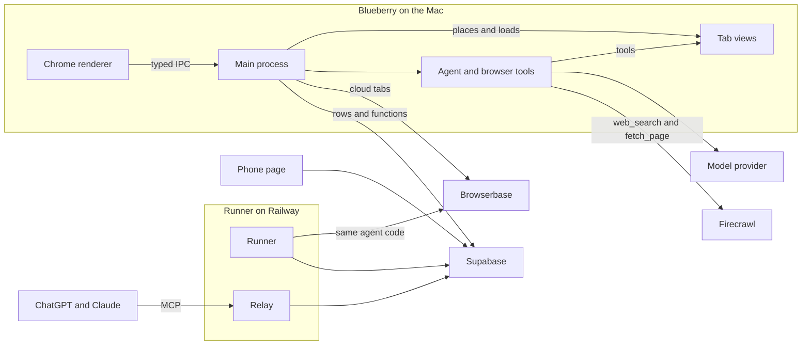

# How Blueberry fits together

A walk through the main parts, in the same order as the map in [AGENTS.md](../AGENTS.md). Each section says how its area works and what it must never do, and [DESIGN.md](../DESIGN.md) has the UI. Many of the rules here are also checks: `eslint.boundaries.mjs` holds who may import what, `eslint.calls.mjs` who may use a few members, and their messages say why.

## Windows, views and the layout

A window is a `BaseWindow` holding a stack of `WebContentsView`s ([src/main/window/WindowParts.ts](../src/main/window/WindowParts.ts)), behind [src/main/window/Window.ts](../src/main/window/Window.ts), which is all its callers see. At the bottom is one window-sized chrome view, which draws the sidebar or tab row, the toolbar, the chat panel and the glass. Above it is one view per tab, with no preload and no Node access. On top sit small views for anything that floats over a page:

- the overlay view ([src/main/window/Panels.ts](../src/main/window/Panels.ts)), for the collapsed sidebar when it slides out, and in the horizontal layout for Chats, a mascot's card and the account menu opened from the toolbar (`Window.openPopover`);
- the find bar ([src/main/window/FindBar.ts](../src/main/window/FindBar.ts));
- a tooltip that hangs over the page ([src/main/window/TooltipView.ts](../src/main/window/TooltipView.ts)), which the chrome's `TooltipProvider` sends there and draws everywhere else itself;
- a tab's preview card ([src/main/tabs/TabPreviews.ts](../src/main/tabs/TabPreviews.ts));
- the address suggestions ([src/main/window/AddressSuggestions.ts](../src/main/window/AddressSuggestions.ts));
- menus and Asking first cards ([src/main/menus/MenuView.ts](../src/main/menus/MenuView.ts));
- and the site permission prompt ([src/main/settings/PermissionPromptView.ts](../src/main/settings/PermissionPromptView.ts)).

Views stack by order, so CSS in the chrome can never draw over a page. That's why floating things get views of their own, each only as large as what it shows, except what opens from the horizontal toolbar: its view covers everything under the toolbar, so a press outside the panel closes it.

`Window` hands every call to `WindowParts`, which makes the views and the services and holds the parts that do the work, each in `src/main/window/` with one job: `TabStrip` the tabs, `WebTabs` a web page's tab, `Panels` the panels and where views go, `WindowSession`, `LibraryUpdates`, `WindowMenus`, `SavedSites`, `BrowsingHistory`, `SettingsChanges` and `PageCommands`. The `make*.ts` files wire each service to it. Parts reach each other through `WindowParts`, never through `Window`.

Every chrome view loads the same React renderer in [src/renderer/chrome](../src/renderer/chrome), with a `view` parameter saying which part to draw ([src/main/window/chromeView.ts](../src/main/window/chromeView.ts)). Internal pages, such as the new tab page, Your mascots, Routines, Needs you and Settings, open as tabs with no web view, drawn by the chrome on the same card a web page sits on.

[src/main/window/Layout.ts](../src/main/window/Layout.ts), with [floatingPlaces.ts](../src/main/window/floatingPlaces.ts) for the views that float over the window and [desktopPlaces.ts](../src/main/window/desktopPlaces.ts) for the drop on the desktop, is the only place that decides where regions go. `computeLayout` turns the window size, layout mode and panel widths into rectangles. `Panels` places the tab views with them and sends the same rectangles to the chrome renderer, which draws each region there. Nothing else hard-codes a size.

### Menus

[src/main/menus/MenuView.ts](../src/main/menus/MenuView.ts), `ownMenu.ts` and [MenuApp.tsx](../src/renderer/chrome/src/MenuApp.tsx) draw every menu and every Asking first card (DESIGN.md section 8), in the `menu` view over everything in the window, or the `drop-menu` panel for the desktop mascot. Main describes a menu as `OwnMenuItem`s, and `buildMenu` turns them into rows whose ids mean something in that one menu, keeping what each does in main. The view answers `menu:choose` with an id, acted on once, and `menu:answer` settles only the question it came with, so a stale id, another question or the window closing is no. Only those views may call the `menu:*` channels, so no page, tool, mascot, MCP app or phone can open, read or answer either. `appMenuItems` in [src/main/menus/Menu.ts](../src/main/menus/Menu.ts) is the one description of the app's menu, for the Mac's menu bar and the ☰ menu. Picking a file or a folder, and `confirmCloudLogin`, stay the system's.

## The typed IPC contract

[src/shared/ipc.ts](../src/shared/ipc.ts) is the one contract between main and the renderer, made of the files in [src/shared/ipc/](../src/shared/ipc/), with the channels in `invoke.ts` and `events.ts`: every invoke channel with its arguments, its result and which chrome view may call it, and every event with what it carries. It's types only, because the preload is sandboxed and can't load shared runtime code. [src/preload/chrome.ts](../src/preload/chrome.ts), the one preload, shared by every chrome view and typed against the contract, exposes it to the renderer as `chromeAPI`, and `chrome.d.ts` beside it gives the renderers its types.

A new invoke channel goes in `invoke.ts` first, then `CHANNEL_REGIONS` in [src/main/window/ipc.ts](../src/main/window/ipc.ts), then the preload. `CHANNEL_REGIONS` is keyed by every invoke channel, so typecheck fails until a new one has an entry, but an empty list passes and no type can say the regions are the right ones. An event channel goes in `events.ts` with what it carries: main sends it with `sendToRenderer` to the view it picks, and no region list covers events, so who gets one is decided where it's sent. [src/main/window/EventManager.ts](../src/main/window/EventManager.ts) registers every handler through one function that checks the caller first. A call is refused unless it comes from the main frame of one of the named views, at the page that view loaded. So a web page, or a frame inside the chrome, can't call anything, and only the permission prompt can answer a permission request.

### Work that finishes later

Much of what main, the runner and the renderers ask for answers after the world has moved on: the account switched, the recording was thrown away, the field was edited, or a newer request went out. [src/shared/lateWork.ts](../src/shared/lateWork.ts) is the one way to tell. `Latest` hands out a `Turn` with `next()`, per key if there's one, and the work checks `turn.current` after each wait and applies nothing once a newer turn has started or `end()` was called because its owner went. A turn's `id` can cross IPC and come back with the answer, as a suggestion list's does. `OneAtATime` runs work for one key after the one before it has settled, as a second publish of a mascot or a second poll on the phone page does. In a renderer, `useLatest` in `src/renderer/common/lib/latest.ts` gives a component its own, ended when it goes. The `late` fence in `eslint.fences.mjs` fails on a counter bumped into a variable to compare later, or anything named `generation`, outside `lateWork.ts`. Menus and Asking first keep `MenuBook` and `AskBook` in `ownMenu.ts`, which also hold what each row does and resolve the question, and `CloudLogins` refuses a second sign-in copy while one waits rather than queueing it.

## The browser itself

Each tab is a [src/main/tabs/Tab.ts](../src/main/tabs/Tab.ts) around its own `WebContentsView`, with no preload and no Node access. `Tab` is only what callers see, and its parts in `src/main/tabs/` do the work: `WebPage` the page in its view and its events, `TabPage` everything Berry does to the page and the hold that stops it, `NavigationLimits` where a limited mascot lets the page go, and `WorkingStyle` the glow while Berry works there. Anything that needs an answer from a page goes through `TabPage.fromPage`, so a crashed or stuck page gives an error rather than a hang.

Open tabs and the layout are saved to `session.json` by [src/main/tabs/Session.ts](../src/main/tabs/Session.ts) soon after each change, and a restored tab gets no view until it's first needed, so a long session opens fast. When a page calls `window.open`, `WebTabs.openLinksInTabs` makes a real popup: a tab around the page Electron made, with the same `TAB_WEB_PREFERENCES` as any tab, so the opener can still talk to it, as "Continue with Google" sign-ins need. It closes when the page closes itself. The chrome's own links still open as plain tabs with no opener.

[src/main/settings/sessionHandlers.ts](../src/main/settings/sessionHandlers.ts) connects downloads ([src/main/library/Downloads.ts](../src/main/library/Downloads.ts), saved to `downloads.json`) and site permissions ([src/main/settings/SitePermissions.ts](../src/main/settings/SitePermissions.ts), saved per origin to `site-permissions.json`) to the session once, before anything loads. A site may use only what the user allowed it, and anything the list doesn't name is refused. `PermissionPromptView.ts` is the only view that can answer a request: `permissions:decide` accepts no other region, and Berry's tools only reach tabs. Renderers name a download by id and never pass a path.

[src/shared/library.ts](../src/shared/library.ts) is what the sidebar and pages show, all of it saved locally. [src/main/library/BookmarkStore.ts](../src/main/library/BookmarkStore.ts) keeps both lists of saved sites, the pinned ones and the bookmarks, in one file, `saved-sites.json`, so moving a site between them is one write. A site is in one or the other: the sidebar shows pins as the favourites' tiles and bookmarks as a list, and `bookmarks:place` moves one between them. Before, each list had a file of its own, `pinned.json` and `bookmarks.json`, which a launch with no `saved-sites.json` reads in, a site saved both ways staying on top, and leaves as they were. The horizontal layout's bookmarks bar shows the same two groups in a row. Find in page and zoom work as in any browser.

[src/main/library/HistoryStore.ts](../src/main/library/HistoryStore.ts) keeps every visit in SQLite, with `importVisits` for bringing history in from another browser. [src/main/library/browserHistory.ts](../src/main/library/browserHistory.ts) reads that from Chromium-format browsers: it copies a profile's `History` file to a temp folder, reads only address, title and time from `urls` and `visits`, and always deletes the copy. Renderers name a source by id and never pass a path, and no tool can reach any of it. `BLUEBERRY_BROWSER_DATA` points it at another folder, only in an unpackaged app, and `tests/app.ts` always sets it so tests never look at real browsers. Safari isn't a source, because it needs Full Disk Access.

### The address field's suggestions

[src/main/window/AddressSuggestions.ts](../src/main/window/AddressSuggestions.ts), [addressSuggestions.ts](../src/renderer/chrome/src/addressSuggestions.ts) and `useAddressSuggestions.ts` in the chrome draw the list under the address field while it's edited. The chrome works out the rows from its own tabs and saved sites and `history:suggest` (`HistoryStore.suggest`), and `addressSuggestions.ts` is pure: what matches, the order, and the inline completion, only ever to a visited or saved address. Main draws them in a view of its own over the page, placed by `suggestionsRect` in `floatingPlaces.ts`, and a press there goes back to the chrome through `address:pick` and `address:picked`, naming the list it was drawn from, so a press reaching main after a newer list never acts on that one's row, and every row acts through the chrome's usual paths: `tabs:switch`, `tab:navigate`, or `chat:send` with no page for asking. Nothing typed is saved or sent anywhere new.

### A tab's preview

[src/main/tabs/TabPreviews.ts](../src/main/tabs/TabPreviews.ts) and [TabPreview.tsx](../src/renderer/chrome/src/components/TabPreview.tsx) are the card shown when the pointer rests on a tab behind (see A tab's preview in DESIGN.md). The chrome runs the tooltip's own steps from `tooltipState.ts` with a longer rest, and sends only the tab's id and where its row is, through `preview:show`. `TabPreviews` decides what the card shows and, through `tabPreviewRect` in `floatingPlaces.ts`, where, and draws it in a view of its own (`TabPreviewApp.tsx`) above the tabs, as long as the window beside the sidebar or as wide as it under the tab row, so following the pointer along the tabs never moves the native view. Each web tab has at most one picture, from `Tab.picture`, taken as the user leaves the tab, without waiting for it, and again while its card shows if a mascot is working there, since a parked tab still draws. It's kept in memory in `TabPreviews` alone, sent only to its view, and dropped when the tab closes. Don't add a route from it to the session, a tool, a chat, MCP, the phone or the disk.

## Chats and the agent

Every chat goes through [src/main/chats/Chats.ts](../src/main/chats/Chats.ts), which saves it to SQLite ([ChatStore.ts](../src/main/chats/ChatStore.ts)) and gets the reply from a LangChain agent built in [src/main/chats/agent.ts](../src/main/chats/agent.ts). The model is OpenAI or Anthropic, from the user's own key (see Account, settings and the AI key) or `.env` (see `.env.example`), and LangChain loads one package at a time once the window has drawn (`loadAhead`), so startup never waits for it and the first message doesn't either. A cheaper model from the same provider names each chat once it has a topic, and does the small jobs elsewhere in the app. A title the user chose is never replaced.

`Chats` is what every caller uses, and hands each job to a part of its own in `src/main/chats`: `Replies.ts` runs a reply or a task, `JobTools.ts` gives it its tools, `Jobs.ts` keeps which tabs each job owns and closes them, `Handoffs.ts` hands a tab to the user and keeps codes out of what goes to the model, `Approvals.ts` waits on the user's answer, `jobMemory.ts` recalls and offers to remember, `modelMessages.ts` is the chat as the model reads it, `WorkView.ts` what the working view shows, and `RunnerChats.ts` the chats on the cloud runner. They share the state `Chats` makes, never a copy of it (`ChatParts` in `chatTypes.ts`).

A run has a step limit of 120 model calls, in `agent.ts`. On the last, tools are taken away and the model is asked to write up what it found, once more if it comes back empty, so a long job doesn't end with nothing.

### Attachments

[src/main/chats/Attachments.ts](../src/main/chats/Attachments.ts), `fileKind.ts`, [src/main/window/pictures.ts](../src/main/window/pictures.ts), `attachmentPrompt.ts` and [src/shared/attachments.ts](../src/shared/attachments.ts) are what the prompt box's + gives a message: an open tab or a file. Every limit is a named constant in `src/shared/attachments.ts`, and main applies all of them. A renderer never names a file by path: a file is main's own dialog (`WindowParts.pickFiles`), and a drop or a paste sends the bytes, never `webUtils.getPathForFile`. `Attachments` keeps each file in memory under an id until `chat:send` takes it, and only a `FileChip` goes back. `sniffFile` decides the kind from the contents alone, never the name or a claimed type, and `pictures.ts` scales a PNG or JPEG down and makes its thumbnail.

`chat:send` names files by id and tabs by id, and `Chats.send` judges both again: the count, `tabProblem` for each tab (held for the user, another job's, off the mascot's sites), and refuses the whole message if anything's wrong. Files are kept in `message_files` in the chat's database, deleted with the chat, and only `ChatStore.filesOf` reads them, for the model: `StoredChat` and the thread a renderer gets have the names only, as `attached`. `attachmentPrompt.ts` puts each file in a `<file>` tag and each tab in a `<page>` tag before the user's words, a file's closing tag escaped, and `agent.ts`'s `forProvider` turns a PDF into the block its provider's LangChain converter passes on, since no one shape works for both.

A file goes with every later message in its chat. A tab's snapshot goes with its own message only, and the chat's tools reach it from then on through `Job.attached`, unless the user has been handed it or another job has it (`inOtherHands`), and never close it. Once the user clicks, types or navigates there it's theirs again, through `releaseTab` as for a tab a job opened, until they attach it again. Its site counts as one the job has been on, through `beenTo`, as a page sent with a message does, and not as named: `said`, and so `asked`, is only what the user typed, so no address in a file or a page skips a card.

Nothing attached goes to the runner, so `send` refuses attachments for a runner chat, and a cloud job takes files but no tab. Attachments have no tool, and aren't in `asHistoryMessage`, `followUpHistory`, `proposalData`, Suggestions' digest, the phone, Telegram, MCP or the relay. Don't add a route to any of them.

## The browser tools

What Berry can do in the browser is in [src/main/tools/browserTools.ts](../src/main/tools/browserTools.ts): `list_tabs`, `read_page`, `find_in_page`, `list_elements`, `click`, `type_text`, `choose_option`, `hover`, `drag`, `press_key`, `screenshot`, `go_to`, `open_tab`, `web_search`, `fetch_page`, `ask_user`, `hand_to_user` and a few more. They're plain definitions that `agent.ts` wraps as LangChain tools. `browserTools.ts` puts them together, in the order the model sees, from a file for each kind (`readingTools.ts`, `pointerTools.ts`, `typingTools.ts`, `askingTools.ts`, `tabTools.ts` and `webTools.ts`), each handed the one context `toolContext.ts` makes per reply. Whether a call asks first is decided in [src/main/tools/askFirst.ts](../src/main/tools/askFirst.ts) (see Approvals and handoffs), and what refuses it in [src/main/tools/mascotLimits.ts](../src/main/tools/mascotLimits.ts) (see Mascots and their limits). Each call shows in the chat as a step, saved with the reply.

### Which tabs a job reaches

While Berry can see a page, the tools reach every open tab. Otherwise they reach only the tabs that chat opened itself, until the user takes one over by clicking, typing or navigating there. Going to a tab to watch doesn't. Every tab Berry opens stays behind the user, and a call naming no tab stays on the job's own tab, not the one the user is on.

While a chat's reply runs, `Chats.jobChatOf` puts its tabs under the chat in the sidebar (`TabInfo.jobChatId`). When it ends, `Jobs.closeJobTabs` closes them, except one the user took over, the last one when the reply names its site (`replyPointsTo` in `jobTabs.ts`), and any held or in use, and saves their addresses on the reply as `pages` through `addressToKeep`. Routine runs close theirs in `Routines`.

### Code that runs in the page

[src/page](../src/page) is the code that runs in web pages, typed against the DOM alone (`tsconfig.page.json`) and linted like the rest. [scripts/buildPage.mjs](../scripts/buildPage.mjs) bundles each export of `src/page/index.ts` by itself into one function expression in `src/main/tools/pageCode.ts`, which is generated and checked in. Page code imports only from `src/page`, and the rest of the app may only borrow its types. Lint holds both, within limits: `eslint.config.mjs` checks the imports of files in `src/page` and one folder below it, and refuses `import()` anywhere in it, and `eslint.boundaries.mjs` checks everything else. A file deeper down has no import check. `buildPage.mjs` refuses a bundle with any runtime input from outside `src/page`, at any depth, but a type-only import never reaches the bundle. [src/main/tools/pageScripts.ts](../src/main/tools/pageScripts.ts) runs them in an isolated world that shares the page's DOM but not its variables, and also reaches same-origin frames: each is a function from `src/page` called with its arguments as JSON through `inPage`, so no value is ever written into the code. Never splice a value into page code: add an argument to the function.

A frame from another origin runs its scripts in its own page's world and gets scripted input, its refs look like `f1.e5`, and it always asks in the default mode, because it can answer anything about itself. Clicks and typing are real mouse and keyboard events sent to the tab's view where they can be ([src/main/tools/pageInput.ts](../src/main/tools/pageInput.ts)), aimed after the page settles, and a press that would land on anything but the named element is stopped. Frames from another origin, native pickers and drags, and a few fallbacks get scripted input instead.

### Firecrawl

With `FIRECRAWL_API_KEY` set, `web_search` asks Firecrawl ([src/main/tools/webSearch.ts](../src/main/tools/webSearch.ts)) for a few results as title, address and snippet, which is faster than opening a search page and reading it. The key stays in main, the results are labelled untrusted, and it asks first unless the query passes `plainSearch`, the same check as data in an address. A mascot limited to sites doesn't get the tool. With the same key, `fetch_page` asks Firecrawl ([src/main/tools/webFetch.ts](../src/main/tools/webFetch.ts)) for a public page's main text as markdown without opening a tab, labelled untrusted and read on with an offset like `read_page`. It goes through `whyCardFor` in `askFirst.ts`, the same check as `open_tab`, since the address goes out to Firecrawl and from there to the site, and it needs `visit`. A mascot limited to sites may only fetch from them, wherever a redirect ends. Firecrawl has none of the user's sign-ins, so Berry opens a tab to click, type, or read a signed-in page.

### One set of tools, two kinds of browser

The tools don't use Electron's tab directly. They work through `PageTarget` ([src/main/tools/pageTarget.ts](../src/main/tools/pageTarget.ts)), an interface of what they need, types only: run a script in the page, list frames from other origins, take a screenshot, send input, load an address, wait for it to settle, and hold the page to allowed addresses for the length of an action. `createPageTools` is generic over it. Add anything new a tool needs there first and to both kinds. `actor` is null where nobody sees a mascot. The tool layer, `pageScripts.ts` and `pageInput.ts` load no Electron, so the runner, which has no window, can use them.

[src/main/tabs/Tab.ts](../src/main/tabs/Tab.ts) is the Electron kind. [src/main/tools/CdpTab.ts](../src/main/tools/CdpTab.ts) is a page in a browser reached over the Chrome DevTools Protocol, in plain Node through `playwright-core`, loaded on first use. It runs scripts in one isolated world per document, sends real input with `Input.dispatch*`, and holds a navigation limit with the `Fetch` domain only while one is on. That's how the same tools run in a Browserbase session ([src/main/cloud/browserbase.ts](../src/main/cloud/browserbase.ts) and [src/main/cloud/cloudBrowser.ts](../src/main/cloud/cloudBrowser.ts)), from the app or from the runner. Tests use a local headless Chrome in its place ([src/main/cloud/localChrome.ts](../src/main/cloud/localChrome.ts)), with a throwaway profile, or one already on 127.0.0.1.

### The mascot on the page

[src/main/tools/PageActor.ts](../src/main/tools/PageActor.ts), [pageActorScript.ts](../src/main/tools/pageActorScript.ts) and `pageActorArt.ts` are the working mascot drawn on the page (see Over a web page in DESIGN.md). `PageActor`, one per `Tab`, decides what shows and how long to wait, and every call does nothing unless the user can see that tab, directly or as a picture in the working view. The tools ask `actorOn(tab)` in `toolContext.ts` first and take their old path with no mascot, and after any flight check that the job wasn't stopped or the tab taken over before acting.

What runs in the page is `src/page/actor`, in the tools' isolated world: a closed shadow root in the top layer, no box and no pointer events, a constructed stylesheet and elements made with `createElementNS`, since a strict CSP and Trusted Types refuse anything else, even from there. It only draws, and takes no clicks. Stop is `tab:stop-work`, in the toolbar, so no page can reach it: don't add a control to the layer. `pageActorArt.ts` is generated from `Mascot.tsx`, `tokens.css` and `tailwind.config.js` by `pnpm run site:build`. `Tab.screenshot` hides the mascot for its capture.

### The working view

Beside the main chat, the working view ([src/main/window/WorkViews.ts](../src/main/window/WorkViews.ts) and [WorkingView.tsx](../src/renderer/chrome/src/components/WorkingView.tsx)) shows live pictures of the tabs a job is using, so the user can watch without leaving the chat. `WorkViews` decides what's captured and how often, and sends words as `work:updated` and pictures as `work:frame`, to the chrome renderer and nowhere else. `Chats.work` says which tabs a job has used and whether each may be pictured. A tab with a picture on screen counts as watched through `Tab.setPictureScale`, so `PageActor` draws there at its usual pace, larger because the picture is small. Parked tabs render and animate normally. `ChatPage` draws `WorkingView.tsx`, so `Layout.ts` isn't involved.

`Tab.picture` is separate from `Tab.screenshot`: it keeps the mascot in, checks again after the capture, and its result goes to nothing but `WorkViews` and `TabPreviews`, never to the model, a tool, a chat or the disk. In main and the runner, `eslint.calls.mjs` refuses a reference to `Tab.picture` outside those two files, and to `capturePage` outside `Tab.ts` and `TabPage.ts`. It sees a call, `.bind`, a literal `["name"]` and destructuring, but not a name held in a variable or a copy of the method under a type of its own, and it can't see where those files send the pixels, so keep them to these. A cloud job's pages are never captured here: the card shows the cloud tab's own live view, locked, or the local test browser's pictures, through `useCloudView` in `cloudView.ts`, so only the big window has one.

## Approvals and handoffs

A tool that changes something has a `describe` function, which gives the exact sentence of what will happen. Depending on the Ask before acting setting, and the tool's own `whyRisky` check, the call pauses through LangChain's human-in-the-loop middleware and shows a card with that sentence. The user answers through `chat:decide`. If the page changed after they allowed it, nothing happens and the model is told to look again.

Whatever decides that a call asks also says why, as one of the codes in [src/shared/asking.ts](../src/shared/asking.ts), with the piece of the card's words it's about, and `whyOnCard` lets that onto the approval as `why` only if the piece is in the words verbatim. The reason a person reads comes from the code in the renderer, never from the model or a page. The action's own words, from `describe`, can hold addresses from the page, and stay on the card in full. `siteNames.ts` in the chrome only shortens addresses for the sentence on top, so the exact words from `describe` always stay under it in full. `ask_user` may offer up to three answers to press, through the same secret check as the question, with any shaped like a code dropped, and a pressed one comes back through `chat:decide` as typed text.

In the default mode `go_to` and `open_tab` ask unless the address is plainly safe: one the user gave, a short search on a listed search page, or a plain address on a site the job has reason to be on, because the user named it, the mascot is limited to it, or this reply or an earlier one in the chat was on it. A reason to be on a site never covers data: a query, a long path, an escape, an `@` or `=`, six digits in a row, a long word or one like hex or base64 in the path or host, or a new subdomain of a site it has only been to. A name or password in an address always asks, on any site. A link on the page changes none of this, since a page can plant links.

Cards show in the chat, on Routines and on the Needs you page, drawn by `ChatApprovalCard` and `ApprovalCard.tsx` everywhere but Needs you. The Needs you page lists everything waiting ([src/renderer/chrome/src/pages/NeedsYouPage.tsx](../src/renderer/chrome/src/pages/NeedsYouPage.tsx)): `Chats.waiting` and `LibraryUpdates.needsYou`, every run with an approval, in the library snapshot. It answers through `chat:decide`.

A sign-in, code or captcha is a handoff. `hand_to_user` makes a `handoff` approval: `Handoffs.handedOver` keeps the tab from every job and every message until the user presses I'm done, which is the only thing that gives it back, and nothing typed goes through us. The model is only told that a code went in, and for an hour `Chats` takes entered codes out of anything it's told, in case the page shows them again, along with the query and fragment of a tab's address just after a handoff. That tab gives no screenshots.

### Needs you on the phone

[src/main/phone/Phone.ts](../src/main/phone/Phone.ts), `phoneReplies.ts`, [TelegramChannel.ts](../src/main/phone/TelegramChannel.ts) and `codeEntry.ts` answer Needs you from the phone, for jobs on this computer. `Phone` decides what to send and what a reply means, through the small `PhoneChannel` interface, and knows nothing about Telegram. `TelegramChannel` is the user's own bot: long polling, pairing, and the token encrypted with `safeStorage`, which never leaves main once saved. `BLUEBERRY_TELEGRAM_API` points it at a fake server, only in an unpackaged app and only at 127.0.0.1. Answers go back through the same `chat:decide`.

A code goes from the reply through `Chats.enterCode` to `codeEntry.ts`, which types it into the field with `Tab.sendInputWhileHeld`, the only way to use a held tab. `eslint.calls.mjs` refuses `sendInputWhileHeld` outside `Tab.ts` and `codeEntry.ts`, and `sendInputEvent`, input straight to the page, outside `TabPage.ts`, which checks the hold first. No tool can reach any of it and the model never gets the code, so don't pass it through `chat:decide`.

## Routines and Show Berry how

A routine is a saved job with a schedule. [src/main/routines/Routines.ts](../src/main/routines/Routines.ts) checks what's due, keeps routines and their runs in `routines.db` ([src/main/routines/RoutineStore.ts](../src/main/routines/RoutineStore.ts)), and runs each through `Chats.runTask`, the same path as a chat with no page, answering approvals through `chat:decide` under the run's id. [src/main/routines/routineSchedule.ts](../src/main/routines/routineSchedule.ts) holds the schedule rules. However many times were missed while the Mac was asleep, one run covers them. A routine can also run in the cloud instead (see The cloud path).

No name is asked for: one saved with none gets its first words (`nameFromWords`), then a name from the cheap model through `writeName`, as a chat's title, from its instructions alone, and `name_settled` keeps one the user chose from ever being replaced.

Show Berry how makes a routine from doing a job once by hand. [src/page/recorder](../src/page/recorder/watch.ts), run by [src/main/recordings/recorderScript.ts](../src/main/recordings/recorderScript.ts), watches the tab in front, and only ever that one, in an isolated world of its own (`RECORDER_WORLD`), not the tools'. It notes clicks, typing, choices, copies and pastes. `Tab.listenInPage` is a long poll: the page answers with what the user did as soon as they do it, which reaches main before a click's navigation, and a new document simply never answers. Secret fields are decided before `.value` is read, so their values never exist outside the page, and `isTrusted` is checked on every event. The clipboard is never read: a copy is the page's selection, or the field's selected range, and a paste is only noted, its text read from the field when the user finishes with it.

[src/main/recordings/recordingTrail.ts](../src/main/recordings/recordingTrail.ts) is pure: the notes the user can read and trim, how addresses lose their query, and what the model may change. The trail lives only in [src/main/recordings/Recordings.ts](../src/main/recordings/Recordings.ts), and `recording:draft` is the only thing that sends it, as tagged data to the cheap model, which writes the routine's steps and what might change next time. Sites come from the trail, in code, not from the model, and the result only fills in the routine's steps (`RoutineSteps.tsx`). A routine's `sites` go through `narrowSites` and the tool layer's `limits`, so they can only take away. A run never asks about a recording, and no tool or mascot can reach one.

## Mascots and their limits

The mascots are saved in `mascots.json` by [src/main/mascots/MascotStore.ts](../src/main/mascots/MascotStore.ts), with Berry always first and never on file. A profile with only Berry gets four starters from the catalog once, through `starters.ts` and `addFromGallery`, marked by the `startersAdded` setting. Tests start without them unless `launchApp` is asked for `starters`. The rules are in [src/shared/mascots.ts](../src/shared/mascots.ts), which is shared runtime code: `parseMascotDraft` checks anything that becomes a mascot, whether typed, copied from the Gallery or sent from the phone, and `narrowSites` combines two lists of sites so the result can only be smaller. `permissionsInWords` is the one source of a mascot's permission wording.

A mascot can only narrow. Its limits reach `createPageTools` as `limits`, which drops tools it wasn't given, and refuses anything off its sites in `run` and in `refuses`, which `agent.ts` checks before asking, so a refused call gets no card. A new tool must be listed in `TOOL_NEEDS`, which says what each tool needs. The filter gives an unlisted tool to no limited mascot, but Berry has no limits, so it would still get the tool: a test in `mascotLimits.test.ts` fails unless a mascot with every permission gets all of Berry's tools. With sites, `screenshot` and the page sent with a message go without a picture while the browser's frame tree has a frame from another site, on screen or not, checked before and after the capture (`showsFrameOffLimits`), and the text says why. Approvals don't read the profile at all. A deleted or missing mascot never falls back to Berry.

`worksInCloud` lives on the profile only, outside `MascotDraft`, so publishing, the phone's copy of the mascots and Gallery copies never carry it, and all it does is turn on Do this in the cloud in the new tab composer. A mascot's name and instructions go into the prompt through [src/main/chats/mascotNote.ts](../src/main/chats/mascotNote.ts), after the safety rules, each in a tag saying what it is, but no limit or approval ever reads the prompt.

### The Gallery

[src/main/mascots/Gallery.ts](../src/main/mascots/Gallery.ts) and [mascotCatalog.ts](../src/main/mascots/mascotCatalog.ts) are what the Gallery lists, the bundled starters and what people published. Everything main sends the page carries a `version`, a hash of what a copy is made from, and `Gallery` keeps each version it sent. Add takes the entry's id and the version the review showed, so main copies exactly that one, even if its author has changed it since or another fetch of the same id came back in between, and refuses a version it never sent. It goes through `MascotStore.addFromGallery` and `parseMascotDraft`. The copy runs like any mascot and never reads the entry again: `galleryId` only tells the Gallery it's added. Examples on starters, in `starterExamples.ts`, come from real runs only, through the `example-` jobs in `evals/`.

[src/shared/publishing.ts](../src/shared/publishing.ts) holds the rules for anything from or to strangers, on top of `parseMascotDraft`. Rows go through `parsePublishedRow` when they're read, whoever wrote them, and invisible characters are taken out so what's reviewed is what the model reads. Publishing sends `publicRow` and nothing else, and main reads the mascot itself, taking only the author, line, category and example from the renderer.

### `blueberry://` links

[src/main/mascots/mascotLink.ts](../src/main/mascots/mascotLink.ts) reads `blueberry://` links, which any website can hand to the system, so treat one as a stranger's. `index.ts` registers the scheme, with `protocols` in `electron-builder.yml` for a packaged app, takes the single-instance lock, and reads links from `open-url` on a Mac and from a second launch's arguments, or the first launch's, elsewhere. Only `blueberry://mascot/<uuid>` is read, by `mascotFromLink`, and anything else does nothing. `Window.openMascotLink` brings the window forward and opens the Gallery tab with the id as its param, plus `gallery:linked` for a Gallery already showing it, and the page asks the server for that one entry through `Gallery.linked` and opens its review.

Every link counts as a new ask, even the same one twice. `linkThrottle` drops the same id again within a few seconds, brings the window forward at most every two, and after three links in ten seconds, whatever the ids, ignores every link for thirty, so a page can't keep taking the front. A link never adds, runs or changes anything, so don't read anything more from one. An unpackaged app registers Electron itself, with the app's folder as its argument. Tests never register: `tests/fakeProtocol.cjs` only writes it down, and a test delivers a link by emitting `open-url` or `second-instance`.

## Memory

What a mascot remembers is in `memory.json` ([src/main/memory/MemoryStore.ts](../src/main/memory/MemoryStore.ts), `mascotMemory.ts` and [src/shared/memory.ts](../src/shared/memory.ts)), apart from the mascot, so nothing that copies or publishes one can take it along (see the memory section of docs/design/DESIGN-bloom.md, until it's redrawn).

After a finished job, `Chats` proposes through `offerToRemember`, and only if `statesAHabit` finds words in what was just typed that go beyond the job, because a mascot should rarely have anything to say. The model only ever gets what the user typed, the questions they answered and the site names, never a page, a step or the reply, so don't add any of those to `proposalData`. An offer lives in memory only and becomes a fact only through `memory:decide`, by id. `factProblem` is the one check on anything stored, and `parseProposals` adds to it for what the model wrote.

`relevantFacts` decides what goes into a job, and `memoryNote` in `mascotNote.ts` puts it in the prompt as preferences. Replies and runs keep only fact ids, so forgetting takes it off them too. Limits and approvals don't read it.

## Suggestions

[src/main/suggestions/Suggestions.ts](../src/main/suggestions/Suggestions.ts), `suggestionDigest.ts`, `suggestionProposals.ts` and `suggestionPatterns.ts` are what the new tab page offers in its suggestions list, drawn as rows by `SuggestionItem.tsx`, with a chat to pick up and starters to try, chosen in `newTabSuggestions.ts`.

[src/main/suggestions/suggestionDigest.ts](../src/main/suggestions/suggestionDigest.ts) is pure: it builds what the cheap model reads, browsing sessions, search queries, chats, routines, the mascots and earlier feedback, each with a short id such as `s3` or `q2`. Page text and full addresses aren't in it, and `searchQuery` is the one place a search engine's address counts, only for its query. The model proposes prompts, routines or new mascots citing those ids, at most about once an hour, and `verifyProposals` in [src/main/suggestions/suggestionProposals.ts](../src/main/suggestions/suggestionProposals.ts) checks every one: the ids exist, sites only come from the evidence, numbers only from what it cites, a schedule only from when the user really looked, and nothing like a dismissed card or something already set up. A routine whose schedule doesn't match when the user really looked becomes a prompt instead. What passes is saved to `suggestions.json` with its sources, and goes when they leave the history.

Without a model or anything valid, the old rules in [src/main/suggestions/suggestionPatterns.ts](../src/main/suggestions/suggestionPatterns.ts) find what's repeated and `fallbackWords` words it in code. Dismissed and used cards are kept as feedback through `suggestions:dismiss` and `suggestions:used`. A card only fills in a form or the composer. `evals/suggestionsCheck.ts` runs the real model once on a made-up profile.

## Berry on the desktop

With it on, which it isn't by default, a mascot waits at the edge of the screen when the user is in another app ([src/main/desktop/DesktopBerry.ts](../src/main/desktop/DesktopBerry.ts), `desktopBerryState.ts`, and [DesktopApp.tsx](../src/renderer/chrome/src/DesktopApp.tsx), [DesktopPanel.tsx](../src/renderer/chrome/src/DesktopPanel.tsx) and `DesktopDrop.tsx`), as a small near-black drop (see On your desktop in DESIGN.md). `DesktopBerry` is only what callers see: every method hands the call to `DesktopParts`, which makes the windows and holds the parts, `DropWindow` the drop, `ComposerPanel` the panel and `JobNews` what the jobs have done.

It's two `panel` windows, made when it's turned on and destroyed when it's off or the main window closes. The clear, unfocusable `desktop` one draws the drop and lets clicks through everywhere but the drop. The `composer` one can take the keyboard without bringing Blueberry forward, and draws the prompt box that ⌥Space opens, grown from the drop's own size and place over it, or the tray and the ask beside it.

All it can do is send a job through `Chats.send` with no page, answer what Needs you answers through `Chats.decide`, and bring Blueberry forward, so it adds nothing a chat can't do. [src/main/desktop/desktopBerryState.ts](../src/main/desktop/desktopBerryState.ts) is pure: what the drop and the tray say, for example that a job finished or needs the user, and `checkDecision`, which lets a decision through only to the ask main showed, from a press on that showing, while it's still the one waiting and unchanged, once, never for a handoff and never with an answer shaped like a code (`plausibleCode`). Main decides what a press opens and holds which ask is showing, the tray's rows and the ask carry keys main made for that one showing, and the view sends only the decision with the ask's key, so it never names a chat or an approval. Nothing is answered while the panel is going away. What comes out by itself, an ask or a result, never carries a site, a step or the exact words: those reach the panel only after Answer.

Placement is in `desktopPlaces.ts`, with the sizes in `src/shared/desktopSizes.ts`. The drop's window keeps one size wherever it stands, the drop grows inside it, and it only covers the work area during a drag. The panel's window changes size only before it shows and between one thing and the next. Clicks pass through the drop's window unless a 50ms check of the pointer finds it over the box the view says it drew. It never reads the screen, the clipboard or another app. `eslint.calls.mjs` guards three ways to: any use of `clipboard`, `desktopCapturer` or `getDisplayMedia` in `src/main/desktop/` and the desktop's own renderer files, those under `src/renderer/chrome/src` whose names start `Desktop`, `desktop` or `useDesktop`, in any folder. Chrome components they borrow are outside it.

## The cloud path

### Cloud tabs and sign-ins

[src/main/cloud/CloudTabs.ts](../src/main/cloud/CloudTabs.ts) is Settings > Cloud and the cloud tabs in the window, internal pages of kind `cloud` drawn by `CloudPage.tsx`. It keeps a Browserbase API key and project id, with `safeStorage` in `cloud.json`, never sent to a renderer. Do this in the cloud sends a chat to the runner whenever one is linked and has accepted (below). Otherwise `Chats.send` with `cloud: true` runs it on `CdpTab`s in a Browserbase session the app holds, and its later messages follow, in memory only. A cloud job reaches only the pages it opened there, never the window's tabs. Its pages show as cloud tabs with the live view locked until the user takes over. The live view address, checked to be Browserbase's, and the local browser's pictures go to the chrome only, never to a tool, a chat or the disk. `BLUEBERRY_CLOUD_LOCAL` (`1`, or an address on 127.0.0.1) and `BLUEBERRY_CLOUD_CHROME` only work in an unpackaged app. Cloud tabs aren't saved with the session.

`CloudSessions` ([cloudBrowser.ts](../src/main/cloud/cloudBrowser.ts)) keeps one session and lets one job claim it at a time. The app makes one for its whole life, the runner one per job, and neither is ever replaced: a new key or Forget changes what's inside it. Its life is in [cloudLife.ts](../src/main/cloud/cloudLife.ts). Starts, endings and key changes run one at a time, and nothing is claimed while an ending is queued or running. The session id is saved as soon as the provider returns it. An ending drops the session's users and pages at once and sends the release for that id straight away, without waiting for a connection, so Quit only waits on releases. A release clears the saved id only if it's still the same one, and one that isn't confirmed stays in Settings > Cloud with Try again. A session nobody uses, with no job, taken tab or check, always has its idle timer armed. `cloudLifetime.test.ts` checks this on thousands of random orders of answers from a fake Browserbase (`cloudWorldTesting.ts`), and prints the seed and shortest trace of any order that breaks it. A popup is never a page of its own: its requests are refused and its address loads only in the tab that opened it.

Settings > Cloud > Signed in to brings sign-ins along one site at a time, into a Browserbase Context that keeps them between sessions. [src/main/cloud/cloudLogins.ts](../src/main/cloud/cloudLogins.ts) is plain Node: `cookiesForSite` and `cookieDomainPattern` decide which cookies are a site's (the site, its subdomains, and domain cookies its parents set for it), and `CloudLogins` asks first, then reads, writes them in with `context.addCookies` through `CloudSessions.withContext`, and keeps `cloud-logins.json` with names, dates and a status only. [cloudLoginAccess.ts](../src/main/cloud/cloudLoginAccess.ts) is the Electron part: Touch ID or a confirm dialog, then one cookie lookup for the site and one for each parent domain, never one for everything, with anything not the site's dropped before it leaves. Browserbase saves them into the Context when the session ends, because it's made with `persist: true`. Only the `cloud:*-login*` channels from the chrome start any of it, and no cookie value goes to a renderer, a log or the disk, so don't print an error from it. `BLUEBERRY_CLOUD_CONFIRM` (`allow` or `deny`) answers the confirm, only in an unpackaged app.

A check tab is opened with `CloudSessions.openForUser`, belongs to no job and is the user's from the start. `hand_to_user` on a cloud page goes through `Handoffs.handOverInCloud`, with the same `handedOver` map as a local tab: the user takes the cloud tab over to type in the live view, and I'm done gives it back through `ChatCloud.giveBack`. A code can't come from the phone there yet.

### The runner

To keep going with the Mac off, jobs become rows in Supabase, and the runner ([runner/](../runner)) runs them: a plain Node service for Railway. It claims its owner's jobs and runs each with the app's own `Chats.runTask` and `cloud: true` ([runner/src/job.ts](../runner/src/job.ts)), so the agent, tools, mascot limits, approvals and step limit are the chat's, in a Browserbase session on the Context id the job carries, ended with the job. Don't give it an agent of its own. `Chats` takes a `ChatStoreLike`, so the runner passes one with no chats.

It signs in to Supabase as a user of its own, with email and password and the publishable key only, through `runnerSession` in `runner/src/db.ts`, never a secret key or JWT secret. It counts as a runner once a row in `cloud_runner_links` links it: the owner offers it from Settings > Connections > Cloud, under with this computer off, by the runner's email, and the runner accepts when it starts, naming `BLUEBERRY_RUNNER_OWNER` back, so nobody can point their jobs at someone else's runner, or make someone's own account a runner. One runner per owner and one owner per runner. `start_cloud_job` needs an accepted runner, and it and accepting a link take the same per-account lock, `lock_cloud_account`, before they check anything, so an account can't end up both a runner and an owner of jobs. The app looks at the link again every few minutes and whenever the new tab page opens.

Owner and runner are both `authenticated`, so no column grant can tell them apart: nobody writes `cloud_jobs` or `cloud_approvals` directly, and every write is a security definer function that checks who's calling with `cloud_runner_for()`. The runner writes steps and approvals back as rows, waits for the decision, and stops after 30 minutes with none. It can read an approval only while its cloud job is unfinished, so past questions and answers stay the owner's. Only `decide_cloud_approval` writes a decision, and it refuses any linked runner, so nothing on the runner can answer, and `Chats.decide` refuses a runner chat's approval from the phone or an app.

[src/main/remoteJobs/cloudJobs.ts](../src/main/remoteJobs/cloudJobs.ts) is pure: what goes into a row and the checks on what comes out, where `mascotFromSnapshot` only lets a mascot through `parseMascotDraft`, Berry's id is unlimited only with no limits in the row, and a job never asks less than the default, so "Never ask" runs as risky. A row is written with the user's session, so a stolen session could queue any mascot, but it could answer the approvals too: the session is the line. A Berry snapshot with sites is Berry on only those, which only narrows.

The runner logs job ids and outcomes and nothing else, so don't log a prompt, page, cookie or code there. `runner/src/quietConsole.ts` keeps only a log line's first words on the runner, since the shared code logs errors whole. With VAPID keys set, [runner/src/push.ts](../runner/src/push.ts) sends a Web Push when a job asks and when it ends other than by the user's own Stop. The payload is only `{ kind }`, "needs-you" or "finished", and goes only to a browser's own push service, so don't add a word of the job to it.

### Runner chats in the app

In the app, [src/main/remoteJobs/RunnerJobs.ts](../src/main/remoteJobs/RunnerJobs.ts) is a `ChatRunner` inside `Chats`, available only once a linked runner has accepted: a runner chat is saved here like any other, and its steps and approval are polled from `my_cloud_jobs` as the signed-in user. A chat is one conversation, `conversation_id` on every job of it, and a follow-up is a new job there carrying the messages before it as `history`, built the same way on both sides by `followUpHistory`, `asHistoryMessage` and `fitHistory` in `src/shared/phone.ts`: the user's words and the mascot's replies with notes of their steps, nothing more.

The app sends each message's start under an id it makes once (`p_id`), and sends it again under that id until the server answers, through `startUntilAnswered`, since a start whose answer was lost may have made the job: `start_cloud_job` gives back the caller's own job with that id before checking anything else, so a repeat never makes a second one. `start_cloud_job` refuses one while another job of the conversation is going, as 409, and a unique index holds it too. It also refuses one whose `p_after_job` isn't the conversation's newest job, the one its history was built on, so a follow-up can't skip an exchange sent from the other side: the app (`RunnerDiscovery.catchUp`) and the phone then read the conversation again, build the history anew and send once more. In the app a runner message waits in `RunnerChats.runnerPending` until the runner has it, so what's brought in first is saved before it. `RunnerJobs.discover` looks every 10 seconds for conversations it didn't send, or that went on elsewhere, and makes or extends the runner chat through `Chats.adoptRunnerChat` and `runnerFollowedUp`. Deleting a chat deletes its whole conversation with `forget_cloud_conversation`, and keeps its id so it never comes back. Each one belongs to the account that sent it: signed out or as someone else, nothing of it shows or can be answered, and it waits rather than ending. The live view address goes through `cloud:runner-view` to the chrome only, and only if it's Browserbase's.

### Routines in the cloud

A routine with `inCloud` runs on the runner instead of here on its schedule, and from then on the server owns when it's due: the Mac's tick never advances it. `Routines.cloudRows` makes its row, with its mascot narrowed by its sites through `mascotSnapshot`, and `RunnerJobs.routinesChanged` keeps `cloud_routines` in step through `sync_cloud_routine`, which takes the schedule, the definition and whether it's paused, and uses the first run it's sent only for a new routine, a changed schedule or a resume. Deletes reconcile against the server's own keys from `my_cloud_routine_keys`, so one that failed is forgotten on a later round or launch. Only this computer's own are ever deleted, the ones it sent or has a routine for, so a second computer on the same account never takes away the first one's.

[runner/src/routines.ts](../runner/src/routines.ts) asks `runner_due_routines`, which gives the runner only a routine's id, schedule, zone and due time, works out the next time with the app's own `nextRun` in that zone, and `runner_start_routine` makes the owner's job and moves the routine on in one step. Each job carries its occurrence, unique per routine, so one occurrence starts at most one job. That job is then claimed and checked like any other, and shows in the app as a runner chat through `discover`.

### The relay

The relay ([runner/src/relay.ts](../runner/src/relay.ts), [relayAuth.ts](../runner/src/relayAuth.ts) and `relayTools.ts`) is a public MCP endpoint at `/mcp` on the runner for ChatGPT and Claude, on only with `RELAY_PUBLIC_URL` and `RELAY_SECRET`. It never keeps the owner's session. `relayAuth.ts` is the OAuth server behind the SDK's `mcpAuthRouter`: clients are signed, not stored, and may only redirect to ChatGPT, Claude or loopback. The sign-in page refuses any account but `BLUEBERRY_RUNNER_OWNER` before sending anything or counting a try. It uses the owner's session once, for `create_relay_grant`, then signs it out, and keeps only the grant's secret. That grant works for nothing until the app that signed in exchanges its code, when `relay_activate_grant` takes it up, within ten minutes, and only then does it count against the 20 that may work at once, so sign-ins left at the redirect can't push out a connection that works. The secret is sealed with `RELAY_SECRET` in `RELAY_STATE_FILE` if set. A reused refresh token ends the connection, and connections end after 30 days idle or 90 days.

Every other call is the runner's own session through the `relay_*` functions in `20261106000000_cloud_relay.sql`, which check the secret's hash, that the grant is the caller's and its link still accepted, and then act as the owner for that one thing. A grant only sees jobs it started (`cloud_relay_jobs`). Unlinking, re-offering or replacing the runner revokes its grants by trigger, and `revoke_relay_grants` is Settings' Disconnect. There's no relay function that decides anything, so don't add one, or any tool that answers: a question or approval waits for the user in the app or on the phone. `relayTools.ts` is the tool layer over a small `RelayHost`: `start_job` sends the phone's snapshot with sites only narrowed by `narrowSites`, and steps and replies go out labelled as untrusted. The runner writes the address to `cloud_runner_links.relay_url` through `runner_set_relay_url`, and the app shows it in Settings > Cloud through `my_cloud_runner`, only an https one.

### Relay jobs on the Mac

[src/main/remoteJobs/MacJobs.ts](../src/main/remoteJobs/MacJobs.ts) and `20261107000000_relay_on_mac.sql` run relay jobs on the user's Mac. `start_job`'s `where` (`auto`, `mac` or `cloud`) goes to `relay_start_job`, which sends `auto` to the Mac only if `mac_available`: the switch `relayOnMac` (Settings > Cloud, off by default) is on in `cloud_mac_presence` and the app was seen in the last minute. `mac` with no Mac gives null, and the relay says Blueberry isn't open there. A Mac job is a `cloud_jobs` row with `target` 'mac', and every runner function and the runner's read policy keep to 'cloud', so the runner never sees one.

While the switch is on, signed in with an accepted runner, `MacJobs` reports presence every 30 seconds, claims one at a time through `mac_claim_job` as the owner, which gives nothing with the switch off on the server, and runs it through `Chats.send` with no page and `from` "ChatGPT or Claude", exactly as an MCP job. The row's mascot goes through `mascotFromSnapshot`, as on the runner, and must be among the local mascots by id, never falling back to Berry. Its `sites`, `tools` and the row's ask level (`askAtLeast`) only narrow the local mascot and the Ask before acting setting in `Chats.send`, and `unlimited` in `JobTools.ts` is Berry only with every tool and no sites. The job is the one reply it started: `Chats.send`'s `onEnd` says how that reply ended, so a follow-up the user types in the chat afterwards never reaches the relay.

Steps, status and the reply go back through `mac_update_job`, cleaned with `withoutCodes`, and its answer says whether the relay asked to stop. Approvals stay on the Mac and only `waiting` reaches the row. Turning the switch off stops the job here at once, then tells the server, which fails what's queued for the Mac, and a claim that comes back after that is failed rather than started. `expire_mac_jobs` ends a Mac job whose app went quiet for 2 minutes, or one nobody took in 5, from `mac_claim_job`, `relay_start_job`, `relay_jobs` and the runner's `runner_claim_job`, so a Mac that's off never holds up the cloud's limit and no job runs twice. The runner ends its own jobs the same way in `runner_claim_job`. Both workers hold a job only while a write was answered within `JOB_LEASE_MS` (in `cloudJobs.ts`), which runs out before the server's two minutes, so neither acts on a job the server may have ended, and neither counts a job as over, or says so, until the server has answered the write that ends it. `discover` and the phone page read only `target=eq.cloud`, so a Mac job never comes back as a runner chat.

### The phone page

[site/app/](../site/app) is the phone page: the user's runner jobs from anywhere, grouped into conversations by `conversationsOf`, static, with no build. [site/app/api.js](../site/app/api.js) is the only way to Supabase, with the publishable key and the user's own session in `localStorage`. It reads `cloud_jobs` and `cloud_mascots` as that user, and a follow-up reads the last job's `history` to build the next, as the same mascot if the phone still has it. It writes only through `start_cloud_job`, `decide_cloud_approval`, `stop_cloud_job` and the push subscription functions. Everything from the server goes in as text.

The live view is a Browserbase frame, locked unless a handoff has been taken over on this phone, and kept in place across polls, because moving an iframe reloads it. A sign-in or a code is typed into that frame and goes straight to the site: there's no field for one on the page, and a question's answer shaped like a code (`plausibleCode`) isn't sent. `sw.js` shows a push as "Berry needs you" or "Berry finished" and nothing else. Words on the page say "in the cloud", never "runner". Settings on the phone holds appearance, kept in `localStorage` by `site/theme.js`, notifications and the account.

`RunnerJobs.mascotsChanged` shares the mascots through `sync_cloud_mascots`, only while signed in with an accepted runner, and only name, look, instructions and limits through `sharedMascotRows` in `src/shared/phone.ts`, never memory. The phone reads them back through `mascotsFromSharedRows`, which puts them through `parseMascotDraft`, and sends the same snapshot as the app, which `mascotFromSnapshot` checks on the runner. A job from the phone takes the Context id from the user's last job, since only the Mac knows it, and the app shows it as a runner chat.

### Supabase and the public site

[supabase/migrations](../supabase/migrations) holds the tables, row-level security, column grants and the `record_add` function, which are the real enforcement, and the cloud runner's jobs, approvals and runner links, and the phone page's shared mascots and push subscriptions, each the owner's only, with the runner reading just its owner's push addresses through `runner_push_subscriptions`. The tests in `supabase/`, such as `gallery.test.ts`, `cloudJobs.test.ts` and `phone.test.ts`, run them on real Postgres in WebAssembly, as the roles Supabase uses. No service key belongs in the repo or the app.

[site/](../site) also holds the public page for a mascot at `site/m/?id=`, static, with no build for the host to run, deployed to Netlify with `netlify.toml`. It reads with the publishable key from `site/config.js`, and everything from the server goes in as text.

## Local MCP

[src/main/mcp/McpConnector.ts](../src/main/mcp/McpConnector.ts), [mcpTools.ts](../src/main/mcp/mcpTools.ts) and `mcpPages.ts` let Claude Code, Claude Desktop and other apps on this computer use Blueberry over MCP, off by default (Settings > Connections > Claude and other apps). It's separate from the relay. `McpConnector` is a stateless Streamable HTTP server on 127.0.0.1 only, refusing any other `Host` and any request without the token, which is kept with `safeStorage` and only leaves main when Copy puts a snippet on the clipboard. It also writes `mcp-bridge.cjs` to the user data folder, for apps that only start stdio servers, run by Blueberry's own binary as Node. The activity log is memory only.

`mcpTools.ts` is the tool layer over a small `McpHost`: a job is `Chats.send` with no page and a `from`, or a routine's `runNow`, so every limit and approval applies as in a chat. `sites` only narrows. An app answers questions through `chat:decide` and never an approval or a handoff, and nothing shaped like a code. It only reaches chats an app started. Everything from a page is labelled as untrusted, and `read_page` goes through Berry's own tool in `mcpPages.ts`, only on a tab that's open already, since opening an address can send data and that's a job's, with its approvals. It reads memory facts but can't change them, and an app's words are never offered for remembering or counted by Suggestions. Account, phone, Telegram, recordings, cookies and passwords stay out of its reach.

## Account, settings and the AI key

[src/main/account/Account.ts](../src/main/account/Account.ts) is email and password, typed in the chrome's own form. The session stays in main, encrypted with `safeStorage`, and renderers, the chrome and the overlay for the account menu, only get the state and the email. No tool or mascot can reach any of it.

Every call from the app to Supabase goes through [src/main/account/galleryServer.ts](../src/main/account/galleryServer.ts), with `fetch` and the publishable key. The fetch fence in `eslint.fences.mjs` only partly holds this: it lets a few files call `fetch` at all, but checks the calling file, not the address, so another of them could still reach Supabase. `serverConfig` refuses any other key, and only an unpackaged app can be pointed at 127.0.0.1, which is how tests use `tests/fakeSupabase.ts`. With `SUPABASE_URL` unset there's no server, and no sign-in or publish control shows.

[src/main/settings/AiKey.ts](../src/main/settings/AiKey.ts) and `aiKeyTry.ts` hold the user's own AI key, from the first run or Settings > Connections > AI service. There's one for the app, made beside the stores in `index.ts`, and each window listens to it while it's open, so a try still on its way when a window closes still loses to anything newer, and an older try that answers after a newer one says `overtaken` and keeps nothing. It comes from the chrome once, through `ai-key:try`, which tries it with one short message to the service from main and keeps it, encrypted with `safeStorage` in `ai-key.json`, only if the service answered. A try only counts once the reply holds a model's answer. Where this computer can't encrypt, it isn't kept, as with the cloud's key. For a saved key, renderers only ever get the service and the last four characters, and only `modelConfig` in `modelConfig.ts` reads the key, through `setSavedKeyReader`, before the `.env` one. The runner and the evals never set it, so they use `.env` alone. In a packaged app a saved key only ever goes to its service's own address (`SERVICE_ADDRESS`), for the try and for every model call, whatever `OPENAI_BASE_URL` or `ANTHROPIC_BASE_URL` say, which only an unpackaged app honours for it. `looksLikeAiKey` takes the service, and is what keeps `ai-key:paste` from handing back anything on the clipboard that isn't that service's key, and one service's key from being sent to the other.

[src/main/settings/SettingsStore.ts](../src/main/settings/SettingsStore.ts) keeps saved settings in the user data folder. Validate anything new in `sanitizeSettings`. It builds the whole `Settings`, so typecheck fails if a new setting is missing from what it returns, but not if it returns the default and drops what was saved. `accountName` is what the account menu calls the user, checked by `cleanAccountName` in `src/shared/accountName.ts`. It's on this computer only, so nothing may send, prompt or publish it.

[src/main/window/AppIcon.ts](../src/main/window/AppIcon.ts) and [AppIcon.tsx](../src/renderer/chrome/src/components/AppIcon.tsx) are Settings > General > App icon. Main can't draw a mascot, so the chrome view draws the chosen icon off screen (`AppIconSender`) and hands main a PNG through `settings:app-icon`, with the mascot and ground it drew. Main treats it as untrusted bytes: it's set only for what's chosen now (`iconMascotId`, which is Berry once the mascot is deleted), as a PNG data address of at most a megabyte, 256 pixels square, that `nativeImage` decodes. It goes on the window on Windows and Linux and the Dock on a Mac, and is kept as `app-icon.png` with `app-icon.json` saying what it was drawn for, so it's set again at launch only while that's still what's chosen. Nothing else crosses: no path, and only the two choices are settings.

## The chrome renderer

[src/renderer/chrome](../src/renderer/chrome) is the one chrome renderer, drawing the sidebar or tab row, toolbar, chat panel, and internal pages such as the new tab page, which open as tabs with no web view. The overlay view loads the same page with `?view=overlay`. Shared code lives in [src/renderer/common](../src/renderer/common).

[src/renderer/common/components/Mascot.tsx](../src/renderer/common/components/Mascot.tsx), with its drawing in `MascotFace.tsx`, `mascotShapes.tsx` and `mascotColours.ts`, is Berry and the mascots, behind `<Mascot mood size look>`. Screens use the chrome's `Berry` wrapper, which applies Show Berry and Keep Berry still. Replace the artwork here without touching screens, and add new components to the gallery page (View > Component Gallery).

[Composer.tsx](../src/renderer/chrome/src/components/Composer.tsx) and `ChatMessage.tsx` are the one composer and message layout, used by the new tab page, the main chat and the chat panel. Change them there so the chats stay alike. Every page of Blueberry's own in a tab is built from `PageFrame.tsx`, and the step card is `StepCard.tsx`, shared by making a mascot and a routine.

Settings ([SettingsPage.tsx](../src/renderer/chrome/src/pages/SettingsPage.tsx) and [src/shared/settingsPlaces.ts](../src/shared/settingsPlaces.ts)) has five sections and pages one step in. Where it is lives in the Settings tab's param, so open it and move around it with `openSettings`, never state of its own. `settingsPlace` reads a param, including the old section names a saved session or an older caller may hold, and `InternalTab.goBack` steps out of a page through `settingsBack`, which is how the toolbar's Back and the Back shortcut work there. `src/shared/shortcuts.ts` holds the shortcuts main registers that the chrome also shows, so the account menu (`AccountMenu.tsx`) and `Menu.ts` can't disagree.

Your mascots ([MascotsPage.tsx](../src/renderer/chrome/src/pages/MascotsPage.tsx), `MascotSteps.tsx`, `MascotMemory.tsx` and `src/shared/mascotsPlaces.ts`) is built like Settings. Where it is, the list, making one, a mascot, one of its parts, its memory or publishing it, lives in the tab's param, so open it and move around it with `openMascots`, and start a new one, filled in or not, with `startMascot`. `InternalTab.goBack` steps out through `mascotsBack`. What's being typed is kept per tab in `mascotsView.ts` for the place it was typed in, and goes when the page moves anywhere else. Every save, a new mascot or one changed part, is the whole draft through `mascots:save`, so `parseMascotDraft` checks it as ever.

Routines ([RoutinesPage.tsx](../src/renderer/chrome/src/pages/RoutinesPage.tsx), `RoutineSteps.tsx` and `src/shared/routinePlaces.ts`) is built the same way. Where it is, the list, making one, a routine or one of its parts, lives in the tab's param, so open it with `openRoutines` and start a new one, filled in or not, with `startRoutine`. `InternalTab.goBack` steps out through `routinesBack`. Changing a part saves the whole routine through `routines:save` with only that part changed (`withRoutinePart`), and with no name unless the name is the part.

## Local data

Everything is saved in the app's user data folder.

| What | Where | Code |
|---|---|---|
| Chats and their files | `chats.db` | [src/main/chats/ChatStore.ts](../src/main/chats/ChatStore.ts) |
| History | `history.db` | [src/main/library/HistoryStore.ts](../src/main/library/HistoryStore.ts) |
| Routines and their runs | `routines.db` | [src/main/routines/RoutineStore.ts](../src/main/routines/RoutineStore.ts) |
| Settings | `settings.json` | [src/main/settings/SettingsStore.ts](../src/main/settings/SettingsStore.ts) |
| Open tabs and layout | `session.json` | [src/main/tabs/Session.ts](../src/main/tabs/Session.ts) |
| Bookmarks and pinned sites | `saved-sites.json` | [src/main/library/BookmarkStore.ts](../src/main/library/BookmarkStore.ts) |
| Mascots | `mascots.json` | [src/main/mascots/MascotStore.ts](../src/main/mascots/MascotStore.ts) |
| What mascots remember | `memory.json` | [src/main/memory/MemoryStore.ts](../src/main/memory/MemoryStore.ts) |
| Suggestions and feedback | `suggestions.json` | [src/main/suggestions/Suggestions.ts](../src/main/suggestions/Suggestions.ts) |
| Downloads | `downloads.json` | [src/main/library/Downloads.ts](../src/main/library/Downloads.ts) |
| Site permissions | `site-permissions.json` | [src/main/settings/SitePermissions.ts](../src/main/settings/SitePermissions.ts) |
| Account session | `account.json` | [src/main/account/Account.ts](../src/main/account/Account.ts) |
| The user's AI key | `ai-key.json` | [src/main/settings/AiKey.ts](../src/main/settings/AiKey.ts) |
| App icon | `app-icon.png`, `app-icon.json` | [src/main/window/AppIcon.ts](../src/main/window/AppIcon.ts) |
| Telegram bot | `phone.json` | [src/main/phone/TelegramChannel.ts](../src/main/phone/TelegramChannel.ts) |
| Cloud key and sign-ins | `cloud.json`, `cloud-logins.json` | [src/main/cloud/CloudTabs.ts](../src/main/cloud/CloudTabs.ts), [src/main/cloud/cloudLogins.ts](../src/main/cloud/cloudLogins.ts) |
| MCP token and bridge | `mcp.json`, `mcp-bridge.cjs` | [src/main/mcp/McpConnector.ts](../src/main/mcp/McpConnector.ts) |

Every other file is written, moved and removed through [src/main/library/savedFile.ts](../src/main/library/savedFile.ts), and nothing else may (`eslint.fences.mjs`). A write goes beside the file and is renamed over it, so the file is always either what it was or what was written, and `saveFile` and `removeFile` never throw: they give back a `Saved`, whether it happened, which `eslint.saved.mjs` won't let a caller drop. So a store keeps a change only once it's saved, or says what not saving means, and never tells anyone something was saved when it wasn't. A file that isn't JSON is moved aside, never deleted, and a list in one is read an entry at a time with `savedEntries`, keeping what checks out and logging what doesn't. `fieldsOf` and `entriesOf` in [src/shared/fields.ts](../src/shared/fields.ts) read anything from outside without a cast, and `eslint.fences.mjs` refuses a cast to an object of unknown fields anywhere else. A call to a server or an API gives back `unknown`, never a type its caller names, and `eslint.answers.mjs` refuses a cast to a type parameter.

The SQLite files are opened through `node:sqlite` by [src/main/library/database.ts](../src/main/library/database.ts), and `inTransaction` makes several writes one. A damaged file is moved aside, never deleted, and the app starts empty for it and says so, with where it went. If moving it stops partway, what moved goes back, and if that fails too, the notice says the file is in two places. Any other failure to open one leaves the file alone and uses an in-memory database for that launch. The account session, the user's AI key, the Telegram token, the cloud key and the MCP token are kept encrypted with Electron's `safeStorage`.

### Secrets

Each secret goes only this way, and its section says more. This is the desktop app: the phone page keeps the user's own Supabase session in the browser's `localStorage`, and the runner signs in with an email and password of its own.

- **The account session** stays in main, in `account.json`. Renderers, the chrome and the overlay for the account menu, only get the state and the email.
- **The user's AI key** comes from the chrome once, through `ai-key:try`, and is kept in `ai-key.json` only if the service answered and this computer can encrypt. A saved key never goes back: renderers only get the service and the last four characters, and only `modelConfig` reads it. Before that, while the user enters one, `ai-key:paste` hands the chrome what's on the clipboard only if `looksLikeAiKey` says it's that service's key.
- **The Telegram bot's token** comes from the chrome once, kept in `phone.json`, and never leaves main once saved.
- **The cloud's key and project id** are kept in `cloud.json` and never sent to a renderer.
- **The MCP token** is kept in `mcp.json` and only leaves main when Copy puts a snippet on the clipboard.
- **Sign-in cookies** go from this computer's browser session to Browserbase, and no cookie value goes to a renderer, a log or the disk. `cloud-logins.json` keeps names, dates and a status only.
- **A code from the phone** goes from the reply through `Chats.enterCode` to `codeEntry.ts`, which types it into the held tab. The model is only told that a code went in, and for an hour `Chats` takes entered codes out of anything it's told.
