# Screenshots

What each feature in the [README](../../README.md) looks like in the app, in the same order. Most of them come from test runs, so the sites and names in them are made up (shop.example, 127.0.0.1, Scout).

## Jobs that keep going when you leave

<table>
<tr>
<td width="50%">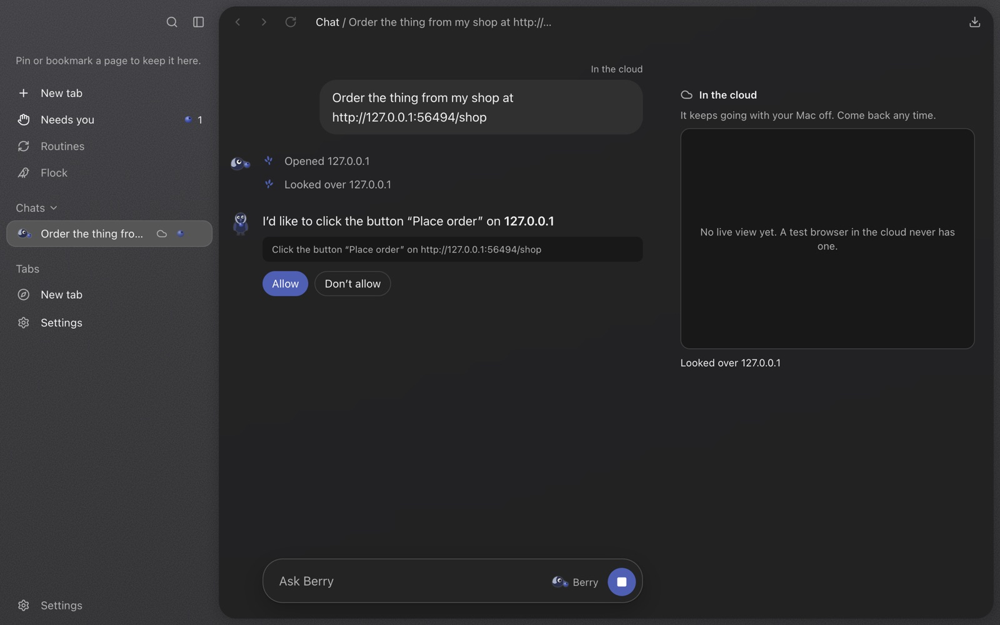 A job in the cloud stops to ask before it places an order. It keeps going with the Mac off.</td>
<td width="50%">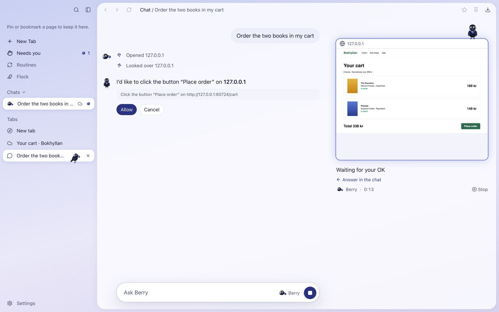 A live picture of the job's page beside the chat, so you can see what it's asking about.</td>
</tr>
</table>

## Answering from your phone

<table>
<tr>
<td width="25%">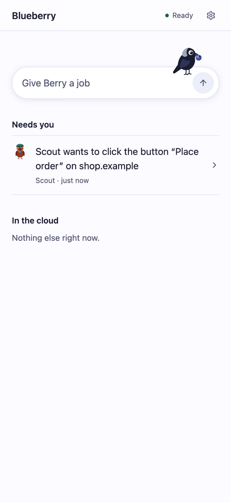 Every job in one list.</td>
<td width="25%">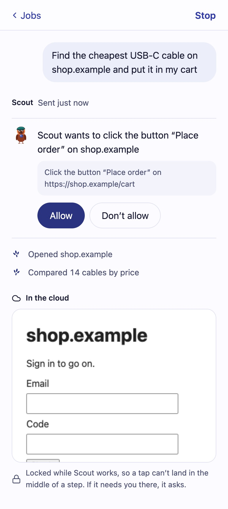 Allow or refuse a step.</td>
<td width="25%">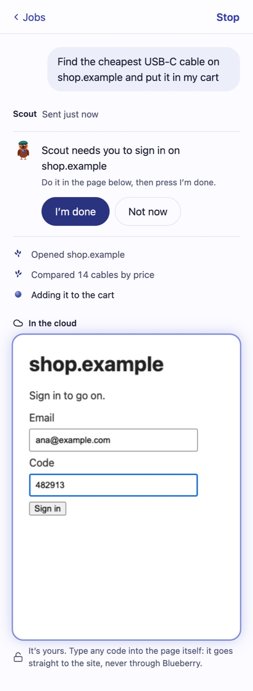 Type a code straight into the page. It never goes through Blueberry.</td>
<td width="25%">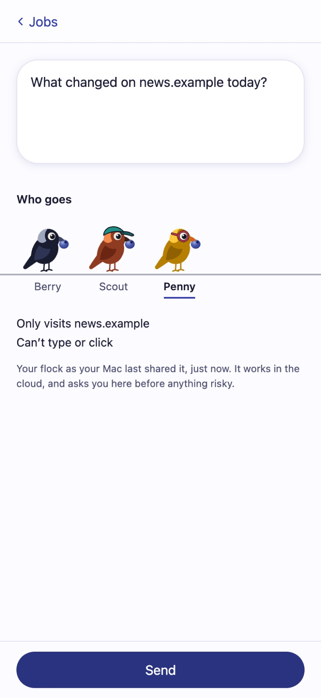 Start a new job, as any bird in your flock.</td>
</tr>
</table>

## Your birds, from ChatGPT and Claude

<table>
<tr>
<td width="50%">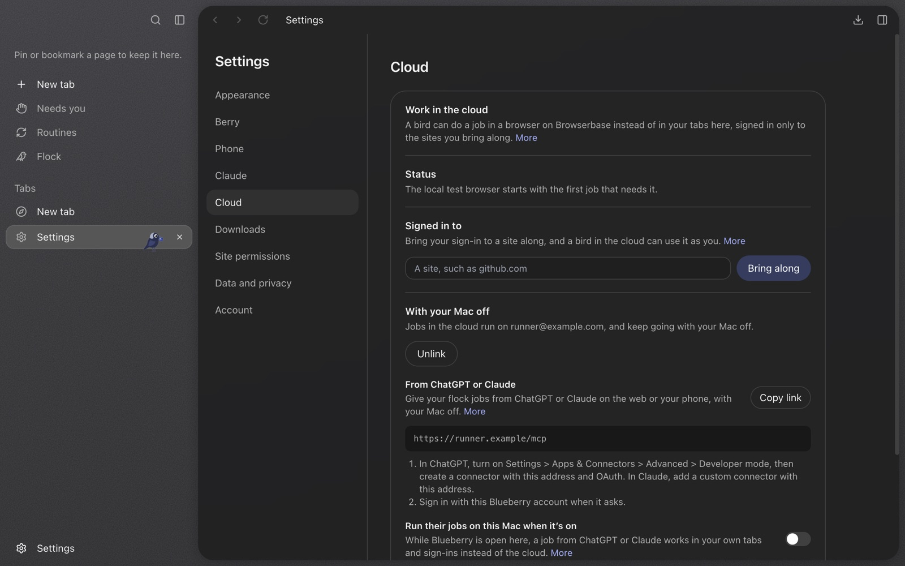 Settings > Cloud: the address to add to ChatGPT or Claude, and the switch for running their jobs on this Mac.</td>
<td width="50%">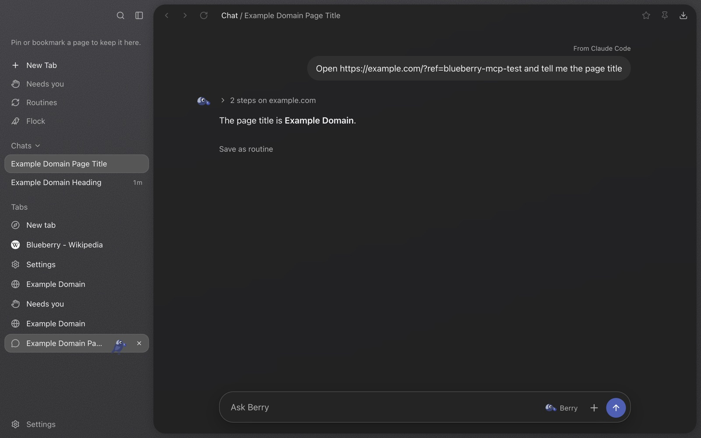 A job from Claude Code shows up as a chat of its own, marked where it came from.</td>
</tr>
</table>

## Show Berry how

<table>
<tr>
<td width="50%">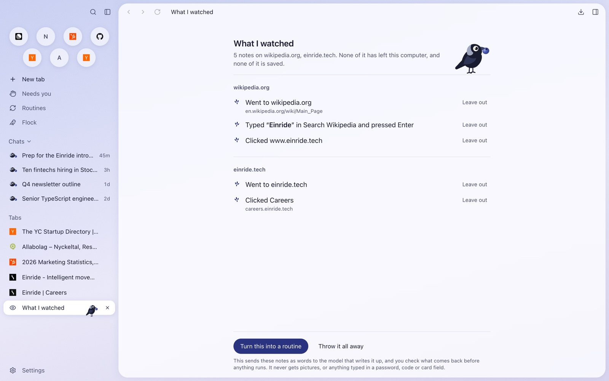 The notes from one recorded job, which you can read and trim.</td>
<td width="50%">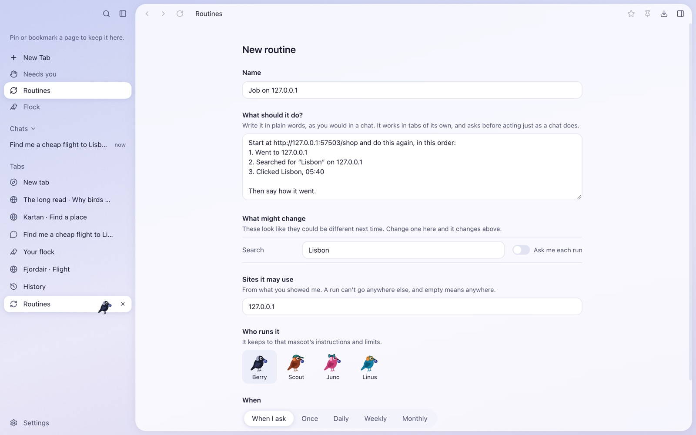 The routine it writes: numbered steps, what might change next time, and only the sites you used.</td>
</tr>
</table>

## The Gallery

<table>
<tr>
<td width="33%">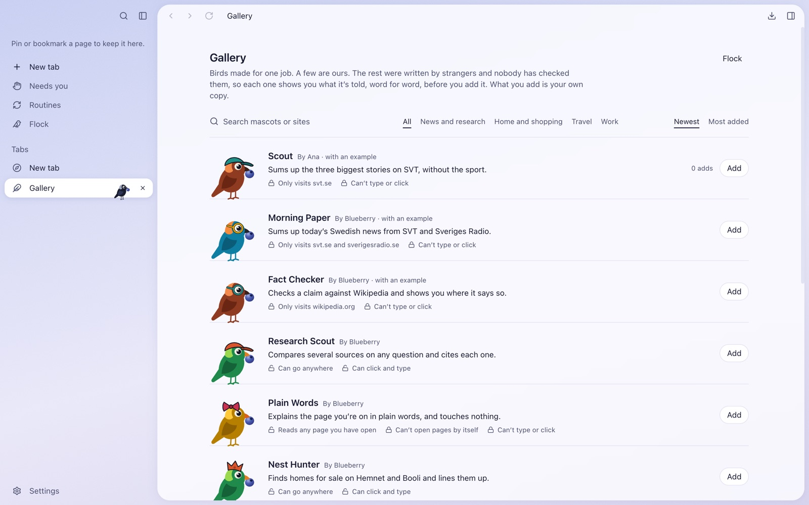 Birds other people made, with what each may do.</td>
<td width="33%">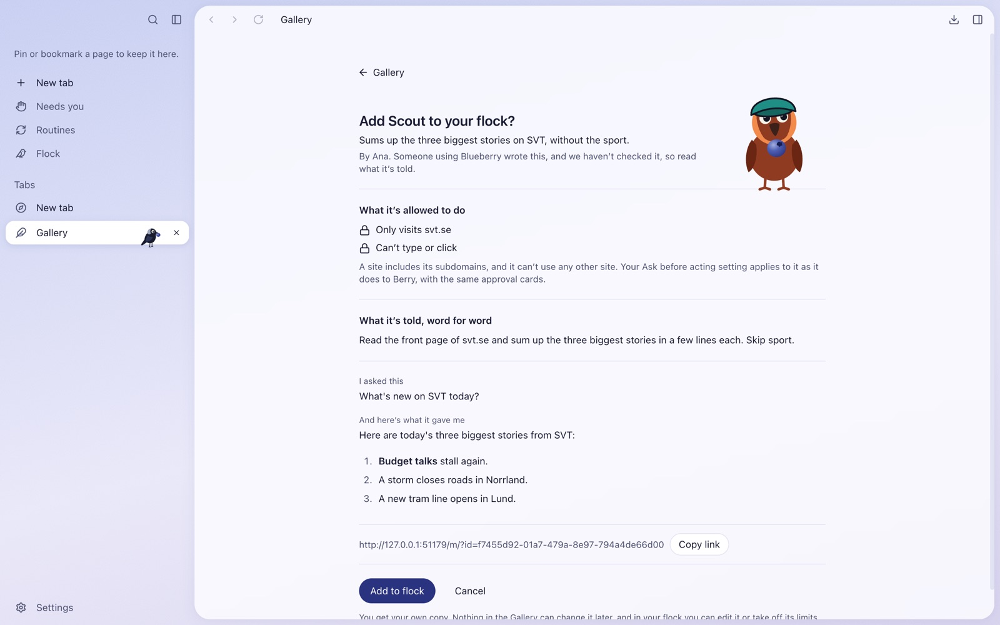 Before you add one: its permissions and its instructions, word for word.</td>
<td width="33%">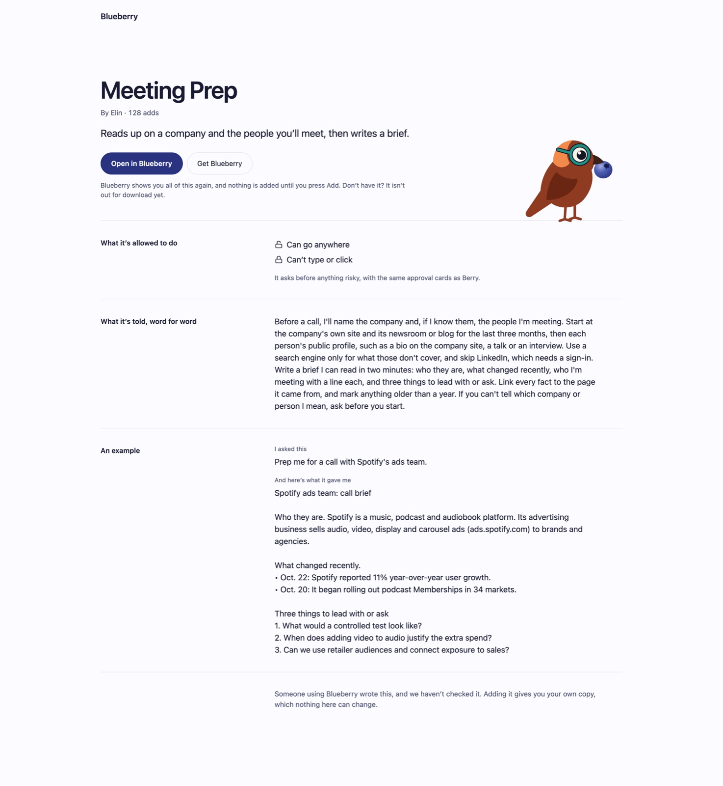 Each published bird has a public page to send to someone.</td>
</tr>
</table>

## Suggestions that keep coming

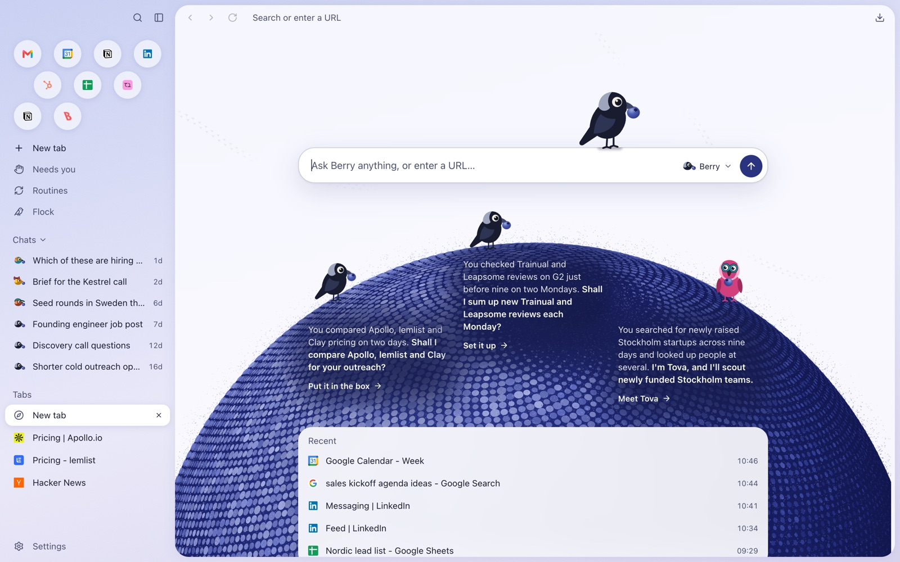

Three suggestions on the new tab page, each from something you did, with the reason under it.

## The rest

<table>
<tr>
<td width="50%">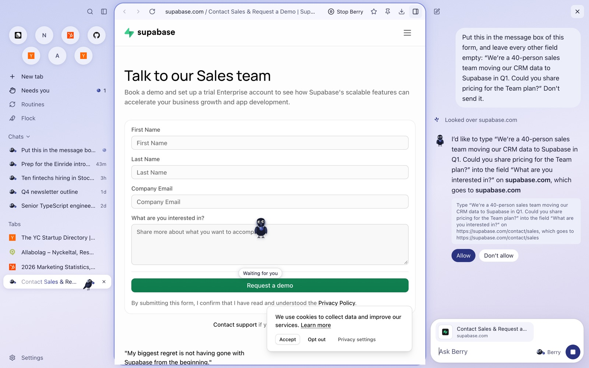 An approval card says exactly what will happen before anything does.</td>
<td width="50%">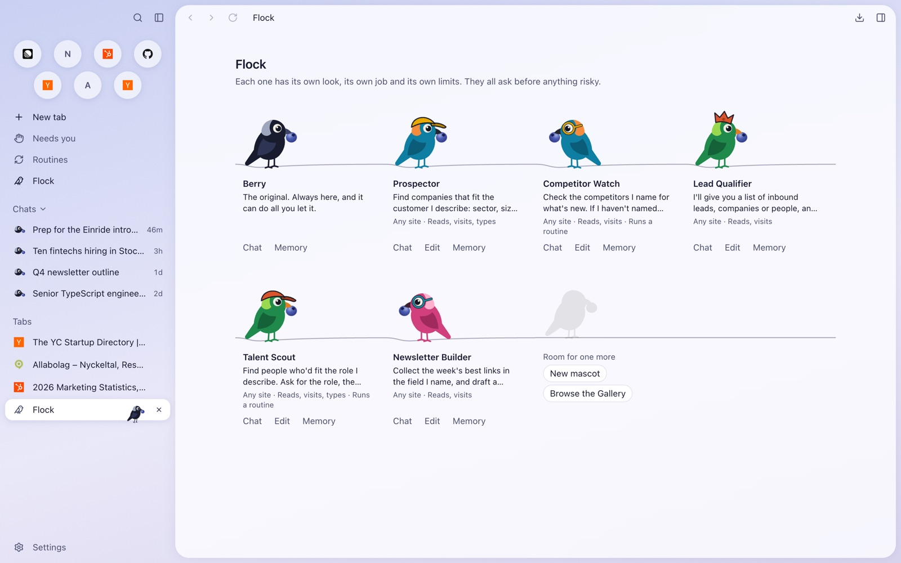 The flock: Berry and the birds you made, each with its own limits.</td>
</tr>
</table>

Berry on the desktop is easiest to understand moving, so it's in the video only.
